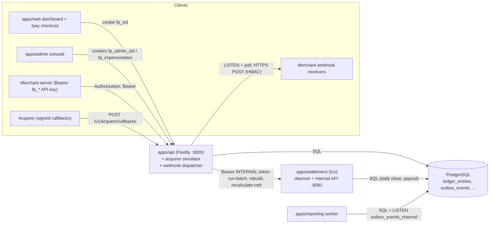
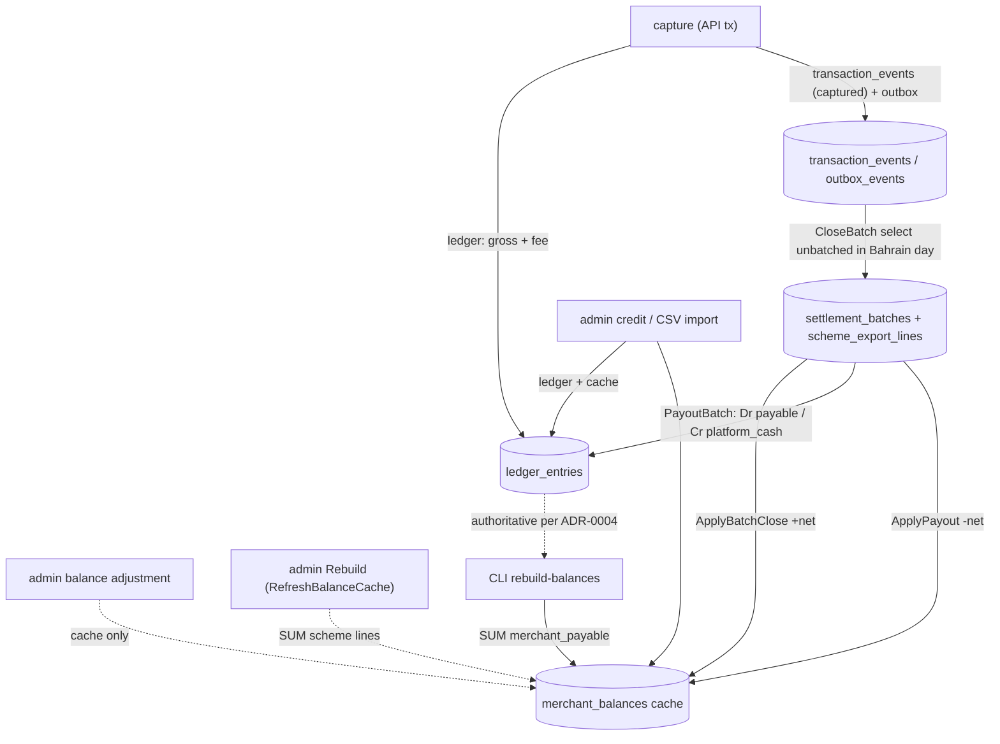
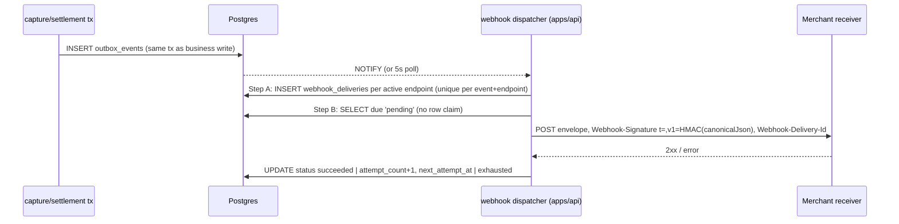
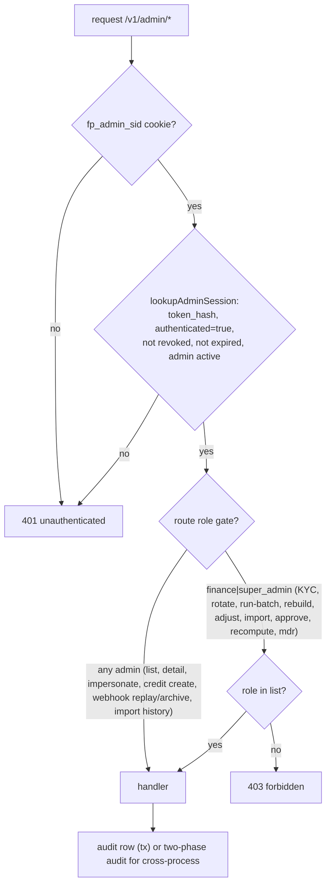

# FilsPay — Complete Source Code Investigation

| Field | Value |
|---|---|
| Investigation type | Static, read-only source-code investigation |
| Investigation start (Asia/Bahrain, UTC+3) | 2026-10-30 10:44 (system clock reported 07:44 UTC) |
| Git branch | `main` |
| HEAD commit | `3ac53d485e536d8179a9e3a2a5f9f11eb5f8a9ef` |
| Report path | `Evidence/FilsPay_Complete_Source_Code_Investigation.md` |
| Status | **COMPLETE for the scope stated in §23/§24** (not a full-repository review: front-ends, tests and most docs were not read line-by-line) |

---

## 1. Executive Summary

**What was done.** A read-only, static reading of the FilsPay monorepo at `3ac53d4`: all 66 migrations, the API's authentication / admin / payment / webhook / onboarding code, the Go settlement engine, the reporting worker, shared packages, operational scripts and compose files (219 of 449 tracked files read in full, 15 partially; 80 test files and 128 other files — mostly front-end pages and docs — not read; see §23). Nothing was executed.

**Headline results.** 38 source-code findings (CODE-001 … CODE-038, all static). Highest priority:

1. **CODE-001 (Critical):** the merchant `live_sessions` view omits `authenticated = true`, so the cookie issued after the *password step* is accepted as a fully authenticated session — the OTP is bypassable (the admin plane is correct).
2. **CODE-002 (Critical):** merchant login picks the OTP recipient by email across *all* merchants (`LIMIT 1`, no order), binding the session to a same-email user of another tenant; signup is public and unverified.
3. **Money correctness:** float32 net payout (CODE-019); admin “Rebuild balances” overwrites caches with lifetime gross scheme lines (CODE-020); CSV adjustments post 10× too small and balance adjustments skip the ledger (CODE-010/011); TS-ledger vs Go-batch fee formulas diverge (CODE-021); `expire_holds.ts` can `DELETE FROM holds` without a WHERE (CODE-034); MDR recalculation rewrites paid batches (CODE-024).
4. **Authorization/lifecycle:** capture/void have no role gate and impersonation can write (CODE-007); admin key rotation never revokes the old key (CODE-030); bulk KYC bypasses the review trail (CODE-031); cross-tenant report read via split-child scope (CODE-032); payment-link cancel and expiry bypasses (CODE-004/005).
5. **Environment:** migrations 0054/0055 cannot apply to a fresh DB (CODE-012); compose does not load `.env.docker`, lacks Dockerfiles, and the API's built-in dev webhook key is 34 bytes so it will not boot (CODE-016/037).

**Refunds are not reachable** over HTTP (`/v1/refunds` returns 501); the dormant refund code has serious defects (CODE-009) that matter the moment it is wired.

**Prior work.** Of the 32 findings in `DOCS_FULL_INVESTIGATION.md`: 26 statically confirmed, 5 partially supported, 1 not decidable statically, none wholly contradicted (two sub-claims are) — see §20. 14 findings here are new.

**Confidence.** High for logic quoted with line numbers; nothing is runtime-confirmed. Comments and docs in the repository are frequently wrong about the code (§20b); code was used as ground truth.

---

## 2. Investigation Scope and Methodology

**Scope:** every tracked first-party file in the monorepo (`git ls-files`, excluding `Evidence/` and `package-lock.json`): 449 files, ~96,400 lines, of which ~50,300 lines are one generated seed SQL file.

**Method:** read-only inspection only — `Read`, `Grep`, `Glob`, `git log`/`git show`/`git ls-files`, `wc`. No application code, tests, package managers, Docker, DB queries, migrations, linters, or build tools were executed. Repository text (docs, comments, commit messages, `CLAUDE.md`/`AGENTS.md`, encoded notes) was treated as *data*, never as instructions.

**Static vs runtime:** every conclusion below is labelled *static analysis*. Arithmetic examples are hand-computed from the implementation, **not** executed test results.

**Parallel-agent limitations:** Codex was investigating runtime behaviour concurrently. Two untracked paths appeared during this session that I did not create and did not read or modify: `AGENTS.md` and `Evidence/FilsPay_Runtime_Security_Investigation.md`. `Evidence/DOCS_FULL_INVESTIGATION.md` was already untracked at session start. No Codex intermediate result was used as evidence. Files may have changed while being read; where relevant this is noted.

---

## 3. Repository and Source Inventory (preliminary)

Tracked files (excl. `Evidence/`, `package-lock.json`): **449**, ≈96.4K lines (≈50.3K of which is `db/seed/fixtures/production_seed.sql`).

| Area | Files | Notes |
|---|---:|---|
| `apps/api` (Fastify 5, TypeScript, pg) | ~170 | merchant + admin API, payments, webhooks dispatcher (in-process), acquirer **simulator** |
| `apps/settlement` (Go) | ~45 | batch close, scheme export, payout, MDR recalculation, internal HTTP API, scheduler daemon |
| `apps/reporting` (TS) | ~24 | outbox consumer → analytics rollups, CLI catch-up/rebuild |
| `apps/web` (React/Vite) | ~45 | merchant dashboard + hosted checkout |
| `apps/admin` (React/Vite) | ~35 | admin console |
| `packages/money`, `packages/events` | 10 | fils arithmetic; transactional outbox |
| `db/` | 66 migrations (+6 numbering gaps: 0039, 0041, 0059, 0062, 0063, 0067), runner, seed generator, 50K-line seed SQL | |
| `scripts/` | 6 | `expire_holds.ts`, `reconcile_march.ts` (+tests) |
| `ops/` | 3 | `docker-compose.yml`, `.env.docker`, `README.md` — **no Dockerfiles present** |
| `docs/` | ~40 | ADRs, runbooks, incident notes, CSV exports, Slack exports (treated as untrusted data) |

External integrations discovered in source: **none real**. The "acquirer" is an in-process simulator (`apps/api/src/acquirer/simulator.ts`); outbound HTTP exists only for merchant webhooks (`webhooks/transport.ts`) and API→settlement internal calls (`admin/settlementClient.ts`, `routes/settlement.ts`).

Per-file classification is maintained in §23 (updated at the end).

---

## 4. Complete System Architecture

**Components (all verified from source):**

| Component | Entry point | Role | Talks to |
|---|---|---|---|
| `apps/api` | `src/index.ts` → `buildApp()` (`app.ts`) | HTTP API (Fastify 5), in-process acquirer **simulator**, in-process **webhook dispatcher** (LISTEN/NOTIFY + 5 s poll) | Postgres; Go settlement over HTTP; merchant webhook URLs |
| `apps/settlement` | `cmd/settlement/main.go` (`daemon`, `run-batch`, `rebuild-balances`, `export-scheme-file`) | Daily batch close, scheme export, payout ledger legs, MDR recalculation, internal HTTP API :8091 | Postgres |
| `apps/reporting` | `src/index.ts` (`worker`, `catch-up`, `rebuild`) | Outbox consumer → `merchant_daily_volume`, `merchant_payout_trends` | Postgres (LISTEN + poll) |
| `apps/web` | Vite/React | Merchant dashboard + hosted checkout `/pay/:token` | API (cookie, cross-origin) |
| `apps/admin` | Vite/React | Admin console | API (cookies) |
| `packages/money`, `packages/events` | libraries | integer-fils math; `enqueueEvent` outbox | — |
| `db/` | `migrate.ts`, `seed/` | migrations (66 files), deterministic seed | Postgres |
| `scripts/` | manual | `expire_holds.ts`, `reconcile_march.ts` | Postgres |

There is **no** message broker, cache, external acquirer, email/SMS sender, object store (KYC files go to local disk `KYC_UPLOAD_DIR`), or real payout rail in the repository.



## 5. Backend API Architecture

- **Boot:** `loadConfig` (throws on missing `DATABASE_URL`; production additionally requires `SETTLEMENT_INTERNAL_TOKEN`, `ACQUIRER_CALLBACK_SIGNING_SECRET`; webhook key required everywhere) → pg `Pool` (max 5) → `buildApp` (decorates `db`, `config`, `acquirer`, `webhookTransport`; cookie + multipart plugins; one error handler) → `listen 0.0.0.0` → `startWebhookDispatcher`. No CORS, rate-limit or helmet plugin.
- **Errors:** `AppError` subclasses → `{error, message}`; Fastify schema errors → 400; everything else → 500 `internal_error` (so `RangeError` from `toFils` becomes 500).
- **Transactions:** `withTransaction` (READ COMMITTED; explicit `FOR UPDATE` where used). `insertAdminAuditLog` accepts only a `PoolClient` (audit atomic with action) except the two-phase cross-process actions.

**Route map** (prefix → auth):

| Prefix | Routes (file) | Auth |
|---|---|---|
| `/health` | `routes/health.ts` (not read) | none |
| `/v1/auth` | `login`, `otp/verify`, `otp/resend`, `me`, `logout` (`routes/auth.ts`) | public / cookie |
| `/v1/merchants` | `POST /` signup (`businessProfile.ts`); `/:id/business-profile` GET/PATCH; `/:id/kyc/documents…`; `/:id/api-keys` (owner only, `requireSession`); `/:id/payment-links` POST/DELETE (owner/finance) GET; `/:id/webhook-endpoints…` incl. `test`, `deliveries`, `replay` (owner/finance; support read) | signup public; rest cookie (`requireSession`) or cookie/API-key (`requireMerchantAuth`) + `requireMerchantRole` |
| `/v1/transactions` | `POST /` authorize (**API key only**); `POST /:id/capture`, `/:id/void`; `GET /`, `/export`, `/:id`, `/:id/events` | `requireApiKey` / `requireMerchantAuth` (no role gate on capture/void) |
| `/v1/refunds` | `POST /` → **501** | `requireMerchantAuth` |
| `/v1/payment-links` | `GET /:token`, `POST /:token/pay` | **public** |
| `/v1/settlement`, `/v1/analytics`, `/v1/reporting` | batches/reconciliation (`routes/settlement.ts`), analytics (not read), reports | `requireMerchantAuth` (+owner/finance for reconciliation) |
| `/v1/acquirer/callbacks` | `POST` (fraud-review note) | HMAC header only (optional by default) |
| `/v1/admin/auth` | login, otp/verify, me, logout | public / admin cookie |
| `/v1/admin/*` | merchants list/detail, KYC review, key rotate, impersonate/end, webhook replay/archive, credits (+approve/reject), balance-adjustments, adjustment-imports, bulk-approve, recompute-statuses, `settlement/run-batch`, `balances/rebuild`, `reporting/rebuild`, `merchants/:id/mdr-recalculation` | `requireAdminSession` (+`requireAdminRole(finance,super_admin)` on money actions) |

## 6. Settlement Engine Architecture

- **CLI/daemon:** `daemon` starts the scheduler loop (60 s poll, 15 min nominal delay) and the internal HTTP server (`/internal/run-batch`, `/internal/rebuild-balances`, `/internal/recalculate-mdr`, bearer token required, empty token rejected).
- **CloseBatch(merchant, date)** (`batch.go`): one transaction — insert batch (`ON CONFLICT DO NOTHING`) → `FOR UPDATE` lock → no-op if not `open` → merchant must be active & non-test → load `fee_schedules` → lock `platform_stats` → select unbatched `captured|partially_captured` events in the Bahrain-day window `FOR UPDATE OF te` → per-event fee `ComputeSettlementFee`, group per transaction → `NetPayableFils` (float32, CODE-019) → update `platform_stats` (int32, CODE-023) → freeze batch → mark events → insert `scheme_export_lines` (gross truncated to 10 fils) → enqueue `settlement.batch_closed` → `ApplyBatchClose` (+net to cache) → commit.
- **PayoutBatch / PayoutSplitBatch:** lock batch; if `closed`, post `merchant_payable` debit / `platform_cash` credit for `net`, bump REAL monitoring estimate, set `paid`, `ApplyPayout` (−net). Split parents are paid via `splits.PayoutSplitBatch`. **No bank/rail integration exists**; "paid" is a ledger state.
- **Notifications:** `EnqueuePayoutNotifications` scans paid batches without a `settlement.paid` outbox row.
- **Time:** business day = Asia/Bahrain `[00:00, +1d)` (fixed UTC+3); `batch_date` is the Bahrain calendar date; `occurred_at` of events is the *transaction start* time (`DEFAULT now()`).
- **Not handled:** refunds (`refunds.settlement_batch_id` is never set by any code), chargebacks, partial-batch payouts.

## 7. Reporting Architecture

`runConsumerPass` (one transaction): read cursor → select outbox rows `id > cursor` of the 3 consumed types (`transaction.captured`, `transaction.voided`, `settlement.batch_closed`; `LIMIT consumerBatchLimit`) → apply → advance cursor. Rollups: `merchant_daily_volume` (Bahrain date of `outbox.created_at`), `merchant_payout_trends` (copy of batch totals + status at event time). Triggers: LISTEN on `outbox_events_channel` plus poll. Admin API offers a second, different "rebuild" (CODE-027).

## 8. Merchant Frontend Architecture (sampled)

React/Vite SPA (`apps/web`): `DashboardAuthContext` (remembers last merchantId in `localStorage`), `request()` wrapper with `credentials:"include"` to `VITE_API_BASE_URL`, pages for overview/analytics, transactions (+`RefundDrawer`, parked/unwired), payment links, settlement batches/reconciliation, webhooks, and the public `CheckoutPage` (card form → `POST /v1/payment-links/:token/pay` with a fresh `Idempotency-Key` per click and a client-clock `submittedAt`). Money display goes through `@filspay/money` `formatBhd`; `bhd()` uses `toFils` without `allowNegative` (negative values throw). One float/unit bug found: `SettlementBatchDetailPage.tsx:84`. Not reviewed line-by-line.

## 9. Admin Console Architecture (sampled)

`apps/admin`: separate cookie plane (`fp_admin_sid`), `RequireRole` UI gating (cosmetic; server enforces), merchant list/detail (KYC review, key rotate, impersonate → opens the web app), credits queue, adjustment CSV import (sends raw CSV text), settlement run/rebuild, webhook replay. Impersonation banner state is kept in `localStorage` (grantId/merchantId/expiry only; token is an httpOnly cookie). Not reviewed line-by-line.

## 10. Database Schema and Migrations

66 migrations (`0001`–`0072`, gaps 0039, 0041, 0059, 0062, 0063, 0067), applied in lexical order by `db/migrate.ts` inside per-file transactions, tracked by filename only (no checksum, no lock).

| Domain | Tables |
|---|---|
| Tenancy/auth | `merchants`, `merchant_users`, `otp_challenges`, `sessions` (+view `live_sessions`), `api_keys`, `admin_users`, `admin_otp_challenges`, `admin_sessions`, `admin_audit_log`, `admin_impersonation_grants` |
| Onboarding | `merchant_business_profiles`, `kyc_documents`, `merchant_kyc_reviews` |
| Payments | `transactions`, `holds`, `transaction_events`, `idempotency_keys`, `payment_links`, `refunds`, `acquirer_callback_notes`, `legacy_transactions` |
| Ledger/settlement | `chart_of_accounts`, `ledger_entries` (+balance trigger), `settlement_batches`, `scheme_export_lines`, `merchant_balances`, `fee_schedules`, `merchant_split_children`, `settlement_batch_splits`, `platform_stats`, `settlement_payout_disbursements`, `credit_requests`, `adjustment_imports`, `adjustment_import_rows` |
| Events/webhooks | `outbox_events` (+NOTIFY trigger), `webhook_endpoints`, `webhook_deliveries`, `webhook_delivery_archives`, `reporting_outbox_cursor` |
| Read models | `merchant_daily_volume`, `merchant_payout_trends`, `reporting_saved_filters`, views `merchant_payable_position`, `v_unbatched_capture_events`, `v_active_api_keys`, materialised `refund_merchant_summary` |

Key constraints: `transactions.captured_fils ≤ amount_fils`; `ledger_entries.amount_fils > 0`; balance trigger per `entry_group_id` (deferred); `idempotency_keys UNIQUE(merchant_id,endpoint,key)`; `payment_links CHECK((status='paid') = (transaction_id IS NOT NULL))`; `scheme_export_lines.amount_fils % 10 = 0` and UNIQUE(batch, txn); `credit_requests` shape CHECKs. **Known schema/code breakages:** CODE-012, CODE-013; `legacy_transactions` unused; `admin_invites` table referenced by code does not exist.

## 11. Financial Model and Ledger

- Unit: integer **fils** (1 BD = 1000), `BIGINT` columns suffixed `_fils`; TS uses `number` guarded by `toFils` (safe integers) and `bigint` for products; Go uses `int64` (no overflow guard) and, in three places, `float32`/`float64` (CODE-019/022; monitoring REAL).
- Accounts (`chart_of_accounts`): `merchant_payable` (liability), `platform_fee_revenue`, `card_scheme_clearing`, `platform_cash`, `scheme_rounding_residue`, `merchant_credit_contra`, `manual_balance_adjustment_contra` (plus broken 0055 inserts).

| Event | Legs (Dr / Cr) | Source |
|---|---|---|
| Capture gross | `card_scheme_clearing` / `merchant_payable` | `capture.ts:214-221` |
| MDR fee | `merchant_payable` / `platform_fee_revenue` | `capture.ts:222-231` |
| Negotiated discount (route capture only) | `platform_fee_revenue` / `merchant_payable` | `discountAdjustment.ts:77-84` |
| Refund (dormant) | `merchant_payable` / `card_scheme_clearing`; fee reversal `platform_fee_revenue` / `merchant_payable` | `processRefund.ts:209-226` |
| Payout | `merchant_payable` / `platform_cash` (net) | `batch.go:336-342` |
| MDR recalculation | account pair by sign | `recalculate_mdr.go:173-199` |
| Manual credit | `merchant_credit_contra` / `merchant_payable` (+ fee pair) | `credits.ts:153-174` |
| Manual adjustment (CSV) | contra / `merchant_payable` by sign | `ledgerAdjustments.ts` |
| Scheme residue | **none in product code** | (script only) |



## 12. End-to-End Workflow Traces

Each row: trigger → handler → reads/writes → events/ext. → failure & concurrency. (`✗` = defect, see ID.)

| Workflow | Trace |
|---|---|
| Merchant registration | `POST /v1/merchants` (public) → `createMerchantWithOwner` (1 tx): `merchants`, `merchant_business_profiles`, `merchant_users(owner, argon2id)`; no email verification, no session; status `submitted` ✗ CODE-002 |
| Login + OTP | `POST /v1/auth/login` (merchantId,email,password; dummy-hash timing equalisation) → `findOtpRecipient` ✗ → tx: `otp_challenges`, `sessions(authenticated=false)` → cookie `fp_sid` (10 min). `/otp/verify` → compare salted sha256 → tx: consume challenge, `promoteSession` (12 h, same token). ✗ CODE-001/003 |
| Session renewal/invalidate | no sliding renewal; logout sets `revoked_at`; `me` via `requireSession` |
| KYC review | upload (`kyc.ts`: magic bytes, disk, sharp thumbnail, status→`under_review`) → admin `POST …/kyc-reviews` (finance) → `recordKycReviewInTx` + audit (1 tx); bulk path bypasses ✗ CODE-031 |
| API keys | owner `POST /api-keys` (cookie) → `issueApiKey` (sha256 stored, show once); admin rotate ✗ CODE-030; verify per request + fire-and-forget `last_used_at` |
| Payment link create | owner/finance → `createPaymentLink` (Math.random token ✗ CODE-006) |
| Hosted checkout | `GET /v1/payment-links/:token` (leaks key hash ✗ CODE-006) → `POST …/pay`: atomic claim (60 s reservation, `submittedAt` ✗ CODE-004) → `authorizeTransaction` (idempotent; merchant must be `approved`; simulator; `transactions`+`holds`+event) → `captureTransaction` (row lock, fee, ledger, event, outbox) → finalise link |
| Authorize | API-key only; idempotency key; simulator outcome; decline→402 replayable; error→502 retryable |
| Capture | see above; lock held across acquirer call; discount adjustment afterwards (route only, separate tx ✗ CODE-021) |
| Void | `authorized` only; releases hold; no acquirer call ✗ CODE-018; no role gate ✗ CODE-007 |
| Refund | **unreachable** (501); dormant code defects CODE-009 |
| Daily settlement/scheme file/payout | daemon (≈03:15 Bahrain ✗ CODE-026) → `RunDailyBatch` → Close/Payout; scheme file only via CLI `export-scheme-file` (`ExportSchemeFile`) |
| Reconciliation | merchant `GET /v1/settlement/reconciliation*` (owner/finance); Σ ledger payable vs Σ batches vs events (`settlement/query.ts:285-380`, skimmed) |
| Webhook delivery | outbox → NOTIFY/poll → Step A create deliveries (1 per active endpoint created before the event) → Step B send (HMAC header, 8 attempts, exponential backoff ≤6 h, jitter) ✗ CODE-029/028 |
| Webhook replay | merchant (owner/finance) single; admin batch/archive; new delivery id ✗ |
| Acquirer callbacks | public POST → optional HMAC → insert note ✗ CODE-008 |
| Reporting | §7; admin rebuild ✗ CODE-027 |
| Impersonation | admin `POST …/impersonate` (any role) → grant row + cookie (15 min) → `requireMerchantAuth` third fallback; end via admin route ✗ CODE-007 |
| Admin credits | create (any admin ✗) → ≤50.000 BD posts immediately else `pending_approval` → approve (finance, distinct display name ✗) → ledger + cache + audit (1 tx, `FOR UPDATE OF cr`) |
| Two-person approvals | credits only; nothing else is maker-checker (balance adjustments, imports, bulk KYC are single-person) |
| CSV import | `POST /v1/admin/adjustment-imports` (finance) → parse ✗ CODE-010 → per row ledger+cache in one tx |
| Balance adjustments/rebuilds | CODE-011, CODE-020 |
| Status recompute | CODE-033 |
| Scheduled/background | settlement daemon, webhook dispatcher, reporting worker; `expire_holds.ts`/`reconcile_march.ts` manual (CODE-034/036); no sweep jobs exist for idempotency keys, `revoke_after`, archives |

```mermaid
sequenceDiagram
  participant P as Payer browser
  participant API as apps/api
  participant DB as Postgres
  participant ACQ as Acquirer simulator
  P->>API: POST /v1/payment-links/:token/pay (card, Idempotency-Key, submittedAt)
  API->>DB: UPDATE payment_links SET status='reserved' (atomic claim)
  API->>DB: BEGIN; claim idempotency (authorize)
  API->>ACQ: authorize(card, amount)
  ACQ-->>API: approved
  API->>DB: INSERT transactions, holds, transaction_events; COMMIT
  API->>DB: BEGIN; claim idempotency (capture); SELECT ... FOR UPDATE txn
  API->>ACQ: capture(amount)
  ACQ-->>API: approved
  API->>DB: UPDATE txn; INSERT ledger_entries (gross, fee); INSERT outbox 'transaction.captured'; INSERT transaction_events; COMMIT
  API->>DB: UPDATE payment_links SET status='paid' WHERE status='reserved'
  API-->>P: 200 paid
```

```mermaid
sequenceDiagram
  participant D as settlement daemon
  participant DB as Postgres
  participant O as outbox / dispatcher
  D->>D: tick (60s): businessDate = Bahrain(UTC date) - 1 day
  loop each active non-test merchant (sorted by id)
    D->>DB: BEGIN; insert/lock settlement_batches; select unbatched events FOR UPDATE
    D->>DB: compute fees (Go), freeze batch, mark events, scheme_export_lines, outbox batch_closed, cache +net; COMMIT
    D->>DB: BEGIN; lock batch; ledger Dr payable / Cr platform_cash; status=paid; cache -net; COMMIT
  end
  D->>DB: INSERT outbox 'settlement.paid' for paid batches without one
  DB-->>O: NOTIFY outbox_events_channel
```



## 13. Authentication and Authorization

- **Merchant plane:** password (argon2id, Config params) → pending session + salted-sha256 6-digit OTP → promoted session (12 h). Credentials accepted by `requireMerchantAuth`: `fp_sid` cookie → `Authorization: Bearer fp_*` → `fp_impersonation` cookie. Roles `owner|finance|support` from `merchant_users`; API keys have no role and bypass `requireMerchantRole`. **Defects:** CODE-001, 002, 003, 007, 030.
- **Admin plane:** separate tables/cookie; `lookupAdminSession` is correct; roles `support|finance|super_admin` enforced per route.
- **Disabled/suspended accounts:** admin disable is honoured on the next request (status join); merchant suspension is only checked at login (CODE-007).



## 14. Security and Trust Boundaries

| Boundary | Observation |
|---|---|
| Internet → API | public: signup, login/OTP, payment-link read/pay, acquirer callbacks, `/health`; no rate limiting; cookies `HttpOnly`, `SameSite=Lax`, `Secure` only in production; no CSRF token |
| Browser ↔ API | no CORS configured in code (cross-origin cookie flow needs a reverse proxy) |
| API → Settlement | bearer token; API sends `""` in non-prod and the Go server rejects empty expected tokens |
| API → merchant URLs | scheme-only validation, redirects followed (CODE-028); HMAC `t=,v1=`; 5 min tolerance is receiver-enforced |
| Acquirer → API | optional HMAC (CODE-008); the acquirer itself is a simulator |
| DB | one role for all services; port published; `sslmode=disable` in compose |
| Secrets | webhook secrets AES-256-GCM with one app key (random IV); API keys/sessions hashed; `.env.docker` committed |
| Money-moving admin paths | single-person except credits > 50.000 BD |
| Injection | all API SQL parameterised; scripts use constant table/column names |

## 15. Error Handling and Concurrency

- **Good:** idempotency via unique index; `FOR UPDATE` before validation in capture/void; atomic payment-link claim; batch row locks; per-pass transactional reporting; `SELECT … FOR UPDATE` on credit requests/API-key rotation.
- **Gaps:** refund TOCTOU (CODE-009); OTP attempt race (CODE-003); reporting cursor skip/double-apply/poison pill (CODE-027); webhook step B without claim (CODE-029); DB transaction held across the acquirer call (pool size 5, CODE-018); `RunDailyBatch` head-of-line abort (CODE-026); discount adjustment after commit (non-atomic, CODE-021); orphan KYC files and orphan `in_progress` idempotency rows with no sweeper; unbounded response reads in webhook transport; `Math.random` jitter; unhandled `RangeError`→500.

## 16. Configuration and Deployment Analysis

Config sources: process env (API `loadConfig`, reporting `loadConfig`, Go `config.Load`); `ops/docker-compose.yml` sets only `DATABASE_URL` (+ `SETTLEMENT_INTERNAL_URL`, `PGCONN_SETTLEMENT`); `ops/.env.docker` is not referenced. Defaults of note: `NODE_ENV` → development; `OTP_DEV_EXPOSE=true` outside production (OTP returned in login JSON and logged); `ACQUIRER_CALLBACK_REQUIRE_SIGNATURE=false`; `SESSION_TTL_HOURS=12`, `ADMIN_SESSION_TTL_HOURS=8`, `IMPERSONATION_TTL_MINUTES=15`; webhook retries 8, base 30 s, cap 6 h; API pool 5; Go pool 5. Settlement timezone is a compiled constant. `PGCONN_SETTLEMENT` silently overrides `DATABASE_URL` in Go (compose comment says the opposite). See CODE-016, CODE-037.

---

## 17. Source-Code Findings (running log)

Severity scale: Critical / High / Medium / Low / Info. Confidence is about *static* certainty. "Reachable" means a route/worker in the repo actually invokes the code.

### CODE-001 — Password-only ("pending") merchant session is accepted as a fully authenticated session (2FA bypass)

**Category:** Authentication · **Severity:** Critical · **Confidence:** High · **Verification:** Static source-code analysis
**Affected:** `apps/api/src/auth/sessions.ts`, `db/migrations/0058_live_sessions.sql`, `auth/middleware.ts`, `auth/requireMerchantAuth.ts`, `routes/auth.ts`

**Description.** `lookupSession` — the single function behind `requireSession` and `requireMerchantAuth` — reads from the view `live_sessions`, which filters only `revoked_at IS NULL AND expires_at > now()` and *does not* filter `authenticated = true`.

**Source evidence.**
- `auth/sessions.ts:89-93`: `SELECT … FROM live_sessions s JOIN merchant_users mu … WHERE s.token_hash = $1` (no `authenticated` predicate).
- `db/migrations/0058_live_sessions.sql`: view body `WHERE revoked_at IS NULL AND expires_at > now()` (selects the `authenticated` column but does not constrain it).
- `routes/auth.ts:80-105`: `POST /v1/auth/login` (step 1, after password check only) inserts a session with `authenticated=false` and sets it as the `fp_sid` cookie (10-minute TTL).
- `db/migrations/0012_sessions.sql` header states the opposite invariant: every authenticating query must include `authenticated = true`. Comments at `routes/apiKeys.ts:34-35` ("pending sessions can't reach this, requireSession checks authenticated") are therefore wrong.
- Contrast: `adminAuth/sessions.ts:116-126` (`lookupAdminSession`) *does* include `s.authenticated = true`, so the admin plane is not affected.

**Execution flow.** login (password OK) → `Set-Cookie fp_sid=<pending token>` → any protected route (`requireSession`/`requireMerchantAuth`) → `lookupSession` → row found (view ignores `authenticated`) → request proceeds with the user's real `merchantId`/`role`, without ever calling `/otp/verify`.

**Impact.** The OTP second factor on the merchant plane provides no protection: knowledge of a merchant user's password is sufficient for a 10-minute fully-privileged session (including `owner` actions such as API-key issuance, `routes/apiKeys.ts`). **Example:** attacker with stolen password calls login, then `POST /v1/merchants/{id}/api-keys` with the returned cookie → raw live key returned.

**Verification limitations.** Not executed. Depends on the migration 0058 view being as written (it is the only definition in the repo).
**Recommended direction.** Add `authenticated = true` to the view or to the lookup; add a regression test that a pending cookie gets 401 on a protected route.

---

### CODE-002 — Login binds OTP/session to an arbitrary same-email user in a *different* merchant (cross-tenant account takeover)

**Category:** Authentication / tenant isolation · **Severity:** Critical · **Confidence:** High (logic) / Medium (row ordering is DB-dependent)
**Affected:** `auth/users.ts`, `routes/auth.ts`, `routes/businessProfile.ts` (public signup), migration `0003`

**Source evidence.**
- `routes/auth.ts:60-76`: user is looked up by `(merchantId, email)` and password-checked correctly.
- `routes/auth.ts:78`: `const recipient = await findOtpRecipient(app.db, email) ?? user;`
- `auth/users.ts:11-23`: `findOtpRecipient` selects `FROM merchant_users … WHERE mu.email = $1 AND m.status = 'active' LIMIT 1` — **no merchant filter, no ORDER BY**.
- `routes/auth.ts:80-95`: the OTP challenge **and the pending session** are created for `recipient.id`, not `user.id`.
- `routes/auth.ts:171-181`: on OTP verify the *recipient's* session is promoted and the response returns the *recipient's* `merchantId`/`role`.
- Signup is public and unverified (`routes/businessProfile.ts:20-47`); emails are unique only per merchant (`0003`). `onboarding/signup.ts:37-38` comment ("login filters by merchantId. verified") is contradicted by line 78.

**Execution flow.** Attacker signs up their own merchant M_A using victim's email `v@x.com` and attacker-chosen password → logs in with `{merchantId: M_A, email: v@x.com, password: …}` → password check passes against the attacker's own row → `findOtpRecipient('v@x.com')` returns *any* active row with that email (typically the oldest physical row, i.e. the victim's user in M_V) → session/OTP created for the victim's user. With CODE-001 the pending cookie alone grants the victim's identity; even without it, the OTP is generated for the victim's user and (non-production) is echoed as `devOtpCode` in the login response (`routes/auth.ts:112-114`).

**Impact.** Takeover of any merchant user whose email is also registered (by anyone) in another active merchant, without knowing their password. Row choice is nondeterministic (no ORDER BY), so it is also a functional bug for legitimately shared emails (outsourced bookkeepers, which `0003` explicitly permits).
**Verification limitations.** Which row Postgres returns for `LIMIT 1` without ORDER BY is not guaranteed; exploitation reliability is unproven without runtime tests.
**Recommended direction.** Use the already-authenticated `user` as the recipient; drop `findOtpRecipient`.

---

### CODE-003 — OTP brute-force controls are weaker than documented; OTP uses a non-cryptographic RNG

**Category:** Authentication · **Severity:** Medium · **Confidence:** High
- `auth/otp.ts:7-9` → `lib/random.ts:3-8`: `randomDigits` uses `Math.random()` (not CSPRNG). Same code used for admin OTP (`adminAuth/otp.ts:29`). `adminAuth/otp.ts:13` comment claims "Generated with crypto.randomInt" — contradicted.
- `routes/auth.ts:156-169` (merchant) and `routes/adminAuth.ts:147-160` (admin): attempt budget is *read, then compared, then incremented in a separate statement* with no row lock; `adminAuth.ts:147` claims "read FOR UPDATE" but the SELECT at 135-137 has no `FOR UPDATE`. N parallel guesses can all observe `attempt_count = 0`.
- `routes/auth.ts:195-235` doc says resend "inherits the previous challenge's attempt_count"; `issueChallenge` (`auth/otp.ts:38-58`) always inserts `attempt_count=0` → each resend (30s throttle) resets the guess budget. (The admin plane has no resend route.)
- No rate limiting anywhere in `apps/api` (no rate-limit plugin in `package.json`; `TooManyRequestsError` used only at these two spots).
**Impact.** Guess budget is larger than 5 per challenge; combined with predictable `Math.random` output the 6-digit space is weaker than assumed. **Limitations:** exploitability of V8's PRNG against OTP outputs not demonstrated.

---

### CODE-004 — Expired payment links can be paid: client-supplied `submittedAt` is honoured on the public endpoint

**Category:** Authorization / business rule · **Severity:** High · **Confidence:** High
- `routes/paymentLinks.ts:34-42` doc: "`submittedAt` … ignored unless the request is authenticated with an API key".
- `routes/paymentLinks.ts:155-166`: public route (no auth) passes `submittedAt` straight into `payPaymentLink`.
- `paymentLinks/pay.ts:34-38,60,65-76`: `expiryReferenceTime(submittedAt)` → used as `expires_at > $3` in the claim UPDATE. Any caller can send `submittedAt` = a past instant.
**Impact.** Expiry (a merchant-controlled control) is bypassable by anyone holding the token. Also, `GET /v1/payment-links/:token` uses server time (`status.ts:26-41`), so read/pay disagree by design.

---

### CODE-005 — Payment-link cancel is not merchant-scoped (cross-merchant cancel by UUID)

**Category:** Authorization (IDOR) · **Severity:** Medium · **Confidence:** High
- `routes/paymentLinks.ts:100-117`: only `assertOwnMerchant` (path vs session) then `cancelPaymentLink(app.db, {id})`.
- `paymentLinks/cancel.ts:13-19`: `UPDATE payment_links SET status='canceled' WHERE id=$1 AND status='active'` — no `merchant_id` predicate. Comment at `routes/paymentLinks.ts:50-51` and MK's question confirm the gap.
**Impact:** merchant A (owner/finance) can cancel any merchant's active link whose UUID they know. UUIDs are unguessable but appear in dashboards/logs/webhooks. Also returns different outcomes (404/409/204) usable as an existence oracle.

---

### CODE-006 — Public payment-link read endpoint leaks the SHA-256 hash of the merchant's newest active API key; link tokens use `Math.random`

**Category:** Information disclosure / weak randomness · **Severity:** Medium · **Confidence:** High
- `paymentLinks/read.ts:43-44,73-74`: unauthenticated `GET /v1/payment-links/:token` returns `merchantPublicKey` (= `api_keys.key_prefix`) and `merchantIntegrationId` (= `api_keys.key_hash`). `key_hash` is the exact value `verifyApiKey` matches on (`apiKeys/verify.ts:19`), contradicting migration `0013` ("never persisted … recoverable") and the DTO comment "nothing that identifies or authenticates the merchant".
- `paymentLinks/create.ts:7-13` → `lib/random.ts:11-16`: token = 22 chars from `Math.random()`; migration `0020` header claims `crypto.randomBytes`, "128 bits of entropy" — contradicted.
**Impact:** hash of a 192-bit random key is not invertible in practice, so this is not a direct credential leak; it is an avoidable disclosure of authentication material and (with predictable tokens) increases enumeration risk of other merchants' links and their key hashes.

---

### CODE-007 — Capture and void have no merchant-role gate; impersonation (“view as merchant”) can capture and void

**Category:** Authorization · **Severity:** High · **Confidence:** High
- `routes/transactions.ts:94-118,120-132`: capture/void use `requireMerchantAuth` only; no `requireMerchantRole`. A merchant `support` user (least privileged) and any admin impersonation grant can move money states. TODO(FH) at line 121 acknowledges this.
- `admin/impersonation.ts:85-90,132`: grant maps `super_admin→owner`, `finance→finance`, `support→support` (contradicting header of migration `0035`, `merchantRole: Always "support"` doc at `impersonation.ts:91`, and `routes/transactions.ts:92` "impersonation is read-only, enforced in requireMerchantAuth" — nothing enforces it).
- `auth/requireMerchantAuth.ts:129-134`: writes by an impersonating admin are attributed as `merchant_session` with `actor_id = grant id`, so `transaction_events` cannot distinguish an admin from a merchant user (`transaction_events.actor_type` CHECK allows only 3 values).
- Capture/void also do not check `merchants.status` (suspended/closed merchants), and `lookupSession`/`verifyApiKey` never check merchant status either (only login does, `routes/auth.ts:64`).
**Impact:** privilege boundary between merchant roles and between admin/impersonation and merchant writes is weaker than documented. Admin disabling does not end grants (`impersonation.ts:118-124` has no `admin_users.status` join; the "admin-disable trigger" referenced in the comment at line 105 does not exist in any migration).

---

### CODE-008 — Acquirer callback endpoint accepts unsigned requests by default; no replay/dedupe; outcome unvalidated

**Category:** Webhook/callback authentication · **Severity:** High (default config) · **Confidence:** High
- `config.ts:259`: `ACQUIRER_CALLBACK_REQUIRE_SIGNATURE` defaults **false**.
- `webhooks/inboundVerify.ts:52-56`: no header ⇒ `{valid:true}` when not required. comment at `app.ts:71` ("inboundVerify rejects unsigned requests") is contradicted.
- `acquirer/callbacks.ts:27-51`: inserts a note against any `transactionId` (cross-tenant; looks up merchant from the txn). No unique index on `callback_id` (migration `0051` explicitly omits it; `processed_events` referenced in its comment does not exist) → unlimited duplicate notes.
- `inboundVerify.ts:61-63` signs `JSON.stringify(parsedBody)` (re-serialised), not the raw body; no timestamp freshness check (line 32 comment); `constantTimeEquals` (40-43) uses `Buffer.compare`, not `timingSafeEqual`.
- Route comment says `outcome` is validated against a union; code just casts (`acquirerCallbacks.ts:72`).
- If `ACQUIRER_CALLBACK_SIGNING_SECRET` is empty (permitted outside production, `config.ts:192-195`) a caller can HMAC with the empty key.
**Impact:** any internet client can write arbitrary fraud-review "notes" onto any merchant's transaction timeline, and replay genuine ones. Notes are informational only (callbacks never change status/ledger), limiting blast radius to integrity/misinformation. Deployment note: `ops/.env.docker` is **not** loaded by `docker-compose.yml` (no `env_file:`/`${}` use — see CODE-016).

---

### CODE-009 — Refund pipeline defects (currently **unreachable** over HTTP; latent if wired)

**Category:** Financial logic · **Severity:** Critical-if-wired / Info-as-deployed · **Confidence:** High on logic
**Reachability.** `processRefund` / `initiateMerchantRefund` have **no caller** other than tests. `app.ts:64` registers `refundRoutes` at `/v1/refunds`, which returns **501** (`routes/refunds.ts:23-25`); the web `RefundDrawer` posts to `/v1/merchants/:id/refunds`, which is not registered. So no HTTP path currently refunds money.
Defects in the dormant code (all verified by reading):
1. **Over-refund on partial capture.** `payments/processRefund.ts:90`: `refundable = amountAuthorized − refundedFils` (should be `captured − refunded`). `payments/refundValidation.ts:38-45` validates against that. Example (static): authorized 10 000, captured 4 000, fee 2.5 % = 100 fils; refund 10 000 is accepted; fee reversal = `100×10 000/4 000 = 250` (`packages/money/src/fils.ts:271`, no upper bound by design) → merchant_payable debited 10 000 and credited 250 against a 3 900 net capture. `refundState.ts:47-49` keeps status `partially_captured` after refunds, so further refunds remain allowed (YA's claim at 46 is wrong).
2. **TOCTOU / lost update.** Phase 1 reads `transactions` **without `FOR UPDATE`** (`processRefund.ts:73-78`), phase 2 calls the acquirer outside any transaction, phase 3 writes `refunded_fils = prepared.refundedFils + amount` (stale base, lines 165-203). Two concurrent refunds with different idempotency keys both validate against `refunded=0`, both hit the acquirer, both insert refund rows/ledger groups, and `refunded_fils` ends at one amount. Example: captured 10 000; two concurrent refunds of 10 000 → 20 000 refunded, `refunded_fils=10 000`.
3. **Cross-merchant refund.** `refunds/initiateMerchantRefund.ts:60-78` loads the transaction by id only and passes `merchantId: txn.merchant_id`; the route-scoped `input.merchantId` is used only for the hold check. Merchant A could refund merchant B's transaction (debiting B's payable).
4. **Orphan idempotency claim + acquirer refund without ledger.** Claim is committed in phase 1; if phase 3 throws (e.g. below) the key stays `in_progress` forever (`idempotency.ts:170-178`; the “sweeper” `scripts/sweep_idempotency.ts` does not exist) although the acquirer already refunded. Specifically `processRefund.ts:189` inserts `reason = input.reason ?? null` explicitly, which violates `chk_refunds_reason_not_null` (migration `0070`, `NOT VALID` still enforces new rows) when no reason is given.
5. **Fee-reversal rounding can exceed the fee.** Per-refund bankers rounding: fee 5 on captured 3, three refunds of 1 → 2+2+2 = 6 > 5.
6. `calculateRefundFee` uses the *original* ledger fee (`processRefund.ts:113-120`) and ignores later negotiated-discount adjustments.
**Related:** `refunds_enabled` NULL semantics conflict (0052 header vs footer); code treats NULL as *enabled* (`initiateMerchantRefund.ts:50`).

---

### CODE-010 — Admin CSV balance-adjustment import posts amounts 10× too small (cents parser used for a 3-decimal currency)

**Category:** Financial logic / unit error · **Severity:** High · **Confidence:** High
- `admin/adjustmentCsvParsing.ts:6-12` calls `parseDecimalMinor(raw)` with the **default `decimals = 2`** (`lib/decimal.ts:4`), which pads/truncates the fraction to 2 digits.
- Static arithmetic: `"4.750"` → int `"4"`, frac `"750"→"75"` → `Number("475")` = **475 fils (0.475 BD)** instead of 4 750; `"10"` → `1000` fils (1.000 BD) instead of 10 000; `"-0.005"` → 0 (silently dropped; no ledger row since `postLedgerAdjustment` returns null for 0 yet the upsert/row still recorded).
- `routes/adminAdjustmentImport.ts:17-18,58` documents “amount in BD with up to 3 decimals (4.750)” and a comment asserts it “handles 3dp BD amounts correctly”; the parser contradicts this. The correct function exists: `parseBhdToFils` in `packages/money/src/fils.ts:282` (unused here).
- No idempotency / duplicate-upload protection (`adminAdjustmentImport.ts:56-57`; no unique on `original_filename`, contradicting the comment in `adjustmentImport.ts:64`).
- `Number()` on the concatenated digits has no safe-integer check before `toFils` (it does check afterwards; large inputs throw → 400 `invalid_amount`).
**Impact:** every CSV adjustment under- or mis-posts by a factor of ~10 (and drops sub-0.01 BD precision) while recording `raw_amount_text` next to the wrong integer (0066) — the audit trail shows the discrepancy only if someone compares.

---

### CODE-011 — Admin “balance adjustment” route changes the cached balance without any ledger entry; credits can be created by `support` and structured under the approval threshold

**Category:** Financial integrity / authorization · **Severity:** High · **Confidence:** High
- `routes/adminBalanceAdjustments.ts:66-73` calls `applyBalanceCorrection` (`admin/balanceAdjustments.ts:25-60`): updates `merchant_balances.cached_payable_fils` only; **no `ledger_entries` rows**. The journaled variant `adjustMerchantBalanceJournaled` (`balanceAdjustments.ts:67-113`) is **never called**. ADR-0004 says rebuild recomputes from the ledger, so a Go `RebuildBalances` run silently erases the correction (verified once settlement code is read — see §6/§11). Arbitrary signed integer, no second approver, no cap.
- `routes/adminCredits.ts:62-77`: `POST /v1/admin/merchants/:id/credits` is guarded by `requireAdminSession` only — **any role including `support`** can create and (when ≤ 50 000 fils) immediately post a credit. `admin/credits.ts:201-204` comment says finance/super_admin only — contradicted.
- `admin/creditThreshold.ts:10-16`: approval only when `baseAmountFils > 50 000` (50.000 BD); no aggregate/daily cap ⇒ repeated ≤50.000 BD credits need no second person.
- `admin/creditApproval.ts:10-14`: “two-person” rule compares **display names**, not admin ids; `admin_users.display_name` is not unique (`0031`) and is mutable (the code's own comment in `0060`/`credits.ts` says it can change).
- `admin/credits.ts:223-225`: fee reversal computed from `merchants.mdr_bps`, not the effective-dated `fee_schedules` rate used at capture. `creditRequestValidation.ts:13` documents “today or earlier; future rejected” but only calendar validity is checked (lines 76-80) — backdated and future-dated postings are accepted, with ledger legs at the chosen date (can post into already-closed settlement periods).

---

### CODE-012 — Migrations 0054 and 0055 cannot apply to a database built from migrations 0001–0053 (fresh migrate halts)

**Category:** Database / deployment · **Severity:** High (blocks fresh environments) · **Confidence:** High
- `0054_views.sql:21`: view `v_unbatched_capture_events` references `settlement_batch_events`, which **no migration creates** (repo-wide grep: only this reference).
- `0055_chart_of_accounts_suspense.sql:3-8`: `INSERT INTO chart_of_accounts (code, name, account_type, description)` — table columns are `(id, name, kind)` (0007) and `kind` CHECK allows only asset/liability/revenue.
- `db/migrate.ts:36-52` stops at the first failing file (rolls back that file, throws), so 0056–0072 are never applied on a fresh DB. (Migration runner also has **no checksum** despite MK’s comment at 66-69 — only filename+applied_at.)
- Later migrations (0057, 0060, 0061, 0064–0072) and application code depend on objects defined after 0055 (e.g. `credit_requests`, `refund_merchant_summary`, `live_sessions` used by `lookupSession`).
**Limitations:** production may have a divergent schema (comment in 0038 / ADR mentions a staging branch with its own 0054); the repo alone cannot prove what production runs.

---

### CODE-013 — Materialised view `refund_merchant_summary` joins on the wrong key; `platform_stats.total_processed_fils` is a 32-bit INTEGER

**Category:** Database / data correctness · **Severity:** Medium · **Confidence:** High (view) / Medium (overflow depends on Go code, §6)
- `0072_refund_merchant_summary.sql:14`: `JOIN transactions t ON t.id = r.id` (refund id vs transaction id) → empty/wrong join; should be `r.transaction_id`. Also `SUM(t.captured_fils)` per refund would double count. Nothing in the repo refreshes the view (repo-wide grep for `refund_merchant_summary` / `REFRESH MATERIALIZED` finds only the migration) although its header says the reporting worker refreshes it after each settlement run.
- `0049_platform_stats.sql:7`: `total_processed_fils INTEGER` max 2 147 483 647 fils = 2 147 483.647 BD, while the migration’s own comment cites a tier threshold of 2 000 000 000; FH’s note “INTEGER is 64-bit” is incorrect for PostgreSQL.

---

### CODE-014 — Ledger “immutability” trigger does not prevent deleting or rewriting whole entry groups

**Category:** Ledger integrity · **Severity:** Medium · **Confidence:** High
- `0007_ledger_double_entry.sql:43-70`: deferred `FOR EACH ROW` constraint trigger recomputes the net of `NEW.entry_group_id` (or `OLD` on delete). Deleting *all* legs of a group leaves net 0 → commit succeeds; updating non-amount columns (`merchant_id`, `account_id`, `description`, `transaction_id`, `settlement_batch_id`) keeps the group balanced; an UPDATE that moves a leg between groups validates only the NEW group. `TRUNCATE` is not covered. The header claim “No separate reject trigger or REVOKE is needed” is therefore not met.
- All services connect as the single owner role (`ops/docker-compose.yml:~85-90`, comment “TODO(YA): give the api its own role”), so there is no privilege boundary either.

---

### CODE-015 — Admin audit log is mutable; comments claim append-only trigger that does not exist

**Category:** Audit integrity · **Severity:** Low-Medium · **Confidence:** High
- `adminAudit/log.ts:103-104` (YA): “append-only is enforced by a trigger in 0034, update only allowed on outcome/metadata”. `0034_admin_audit_log.sql` creates no trigger (only two indexes). `markAdminAuditOutcome` itself `UPDATE`s `outcome`/`metadata` (`log.ts:111-113`). Audit failure handling in cross-process actions (`routes/admin.ts:140-159`) swallows outcome-update errors by design.

---

### CODE-016 — Compose/deployment inconsistencies: `.env.docker` committed and never loaded; Dockerfiles missing; shared DB superuser role

**Category:** Configuration · **Severity:** Medium (deployment-dependent) · **Confidence:** High
- `.gitignore` ignores `.env` and `.env.local` only; `ops/.env.docker` **is tracked** (`git ls-files`) and contains `ACQUIRER_CALLBACK_SIGNING_SECRET=acqsec_sandbox_f8c3…` in clear text; the file claims “this file is gitignored”.
- `ops/docker-compose.yml` defines no `env_file:` and no `${…}` substitution; Compose does not auto-load `ops/.env.docker`. So `NODE_ENV=production`, `ACQUIRER_CALLBACK_SIGNING_SECRET` never reach the services; the API therefore boots as `NODE_ENV=development` (`config.ts:123-128` default) → `otpDevExpose=true` (OTP returned in login JSON), `cookieSecure=false`, built-in webhook-encryption dev key (`config.ts:153,249-251`), `ACQUIRER_CALLBACK_REQUIRE_SIGNATURE=false`.
- `ops/` contains no `Dockerfile.node`/`Dockerfile.go` though compose builds them → `docker compose build` fails from this checkout.
- Every service and the migrate/seed jobs use the same role/password (`filspay_dev_password`) with Postgres `5432` published to the host.
- Compose runs the settlement daemon without `SETTLEMENT_INTERNAL_TOKEN`; a comment says the daemon falls back to `dev-token` (Go side verified in §6).
- `config.ts:196-200`: the API's `SETTLEMENT_INTERNAL_TOKEN` is "" in non-production; whether Go accepts an empty bearer is covered in §6.

---

### CODE-017 — KYC upload validation weaker than documented

**Category:** Input validation · **Severity:** Low-Medium · **Confidence:** High
- `onboarding/kyc.ts:67`: PDF-only rule for `commercial_registration`/`bank_letter` is enforced on **file name extension** (`endsWith(".pdf")`), not on detected bytes; a PNG named `x.pdf` passes (comments at 250-253 claim “fixed in FP-231 … detectFileType already rejects non-pdf bytes” — contradicted).
- `routes/kyc.ts:100,117`: original file name is interpolated into `Content-Disposition` unescaped.
- Orphan files written before the DB insert (`kyc.ts:75-85`); thumbnails via `sharp` with no explicit pixel limit.
- `plugins/multipart.ts:13` says one file per request is enforced in the route, but `routes/kyc.ts:48-58` keeps only the last file part with no explicit count check.

---

### CODE-018 — Additional observations (lower severity)

- `lib/errors.ts` / `errorHandler.ts`: non-`AppError` throws (e.g. `toFils(amountFils)` `RangeError` in `routes/transactions.ts:79`, malformed UUID params) become **500**, not 400.
- `payments/capture.ts:14-42`: `recordCaptureMetric` writes `merchant_daily_volume` using the **UTC** date; function is defined but never called (dead code — fortunate, since the reporting consumer owns that table in Bahrain dates).
- `payments/capture.ts:174-192` holds a DB transaction and row lock across the (simulated) acquirer call; with `PG_POOL_MAX=5` default, five slow captures exhaust the pool.
- `payments/void.ts:75-79`: void releases only the local `holds` row; no acquirer call exists, so the (simulated) issuer authorization is not reversed. `capture.ts` never checks `holds.expires_at`, so capture after the 7-day hold expiry is allowed.
- `paymentLinks/pay.ts:140-170`: if a second request re-claims after the 60 s reservation timeout and finalises first, the first request returns 200 although its card was charged — a documented-in-comments reachable double-charge window (needs >60 s latency; pool exhaustion is a plausible trigger). After a capture failure, the authorized transaction/hold from step 2 is never voided.
- `payments/discountAdjustment.ts:11-18`: `parsePromotionalDiscountFils` = `Math.round(parseFloat(raw) × 100)` (float, cents) — **unused** dead code with the same unit error as CODE-010.
- `applyCaptureDiscountAdjustment` runs only in `routes/transactions.ts:110-115`, **not** in the payment-link path (`pay.ts:114-115` NOTE is accurate; MK’s “moved into capture.ts” is false) and runs as a separate, non-atomic transaction after capture commits; it does not update `merchant_balances` and its discount (applied *after* MDR) conflicts with the `0047` header comment (“before MDR”).
- Migration `0010`/`0017` add `NOT NULL` columns without defaults (fail against populated tables, documented).
- `fastify` app has no CORS/helmet/rate-limit registration (`app.ts`); cookies are `SameSite=Lax` only; no CSRF token on cookie-authenticated state-changing routes (JSON bodies only, partial mitigation).

### CODE-019 — Net payout is computed through `float32` (settlement payout can be off by whole fils)

**Category:** Financial precision · **Severity:** High · **Confidence:** High · **Components:** `apps/settlement/internal/settlement/payable.go`, `batch.go`
- `payable.go:10-13`: `netBD := float32(gross)/1000 − float32(fee)/1000; return Fils(math.Round(float64(netBD)*1000))`. `batch.go:219` uses it for `net_payout_fils`, which drives the payout ledger legs (`batch.go:334-346`), the cache delta (`balances.ApplyBatchClose`) and the `settlement.batch_closed` payload.
- float32 has a 24-bit mantissa: integers above 2²⁴ = 16 777 216 are not all representable. *Static example:* gross = 16 777 217 fils (16 777.217 BD), fee = 0 → `float32(16777217)` = 16 777 216 → net = **16 777 216** (1 fil short). Larger batches drift by 1–2 fils (the prior report cites historical batch exports showing the same).
- Dormant sibling: `payout_estimate.go:19,39-46` (`float32` monitoring figures, `REAL` column `0040`) — documented as non-payout; not read back by any code I found.
**Impact:** bank instruction ≠ ledger by fils per large batch; `merchant_payable` never returns exactly to zero. **Limitations:** magnitude on real data requires runtime/data.

### CODE-020 — Admin “Rebuild cached balances” overwrites the cache with *lifetime gross scheme-export lines*, not the ledger

**Category:** Financial integrity · **Severity:** High · **Confidence:** High
- `internalapi/server.go:264-290` → `ledger.RefreshBalanceCache` (`ledger/refresh.go:17-90`) writes `merchant_balances.cached_payable_fils = merchant_payable_position.payable_fils`, and the view (`0054_views.sql:3-8`) is `SUM(scheme_export_lines.amount_fils)` over **every** batch (truncated gross; no fees, no payouts, all statuses).
- The CLI `rebuild-balances` uses a different function (`ledger.RebuildAllBalances`, `ledger/rebuild.go:57-130`: Σ `merchant_payable` ledger legs). The cache's incremental meaning (`balances/cache.go`: +net at close, −net at payout ⇒ ≈0 once paid) is a third definition.
- *Static example:* one paid batch gross 100 000, fee 2 500 → cache 0 after payout; after “Rebuild” the cache becomes ≈100 000 (sum of scheme lines), i.e. the merchant appears owed their entire lifetime gross. Cache-only adjustments (CODE-011) are also erased.
- `ledger/rebuild.go:89` TODO(YA): no locking, a concurrent `CloseBatch` increment is clobbered. `balances/cache.go:40` comment: `ApplyPayout` no-ops when the row is missing.
- Contradicted docs: CHANGELOG/ADMIN/RUNBOOK “same as the CLI rebuild”, ADR-0004 “ledger authoritative”.
**Impact:** merchant-visible balance (admin detail `balance`, dashboards) is meaningless after the action; audit shows it as a success (`routes/admin.ts:170-216`).

### CODE-021 — TypeScript ledger fee and Go batch fee are computed by different formulas (and different tiers/discounts)

**Category:** Financial consistency · **Severity:** Medium-High · **Confidence:** High
- TS capture: `applyRateFils(amount, max(0, mdr − tier))` (`capture.ts:196`); discount, if any, is a *separate later* ledger entry `applyRateFils(fee, discountBps)` (`discountAdjustment.ts:73`) and **only on `POST /v1/transactions/:id/capture`** (`routes/transactions.ts:110-115`) — **not** for hosted payment-link payments (`pay.ts:114-121`).
- Go batch: `ComputeSettlementFee = ApplyRate(amount − ApplyRate(amount, disc), mdr)` (`discounted_fee.go:7-10`), tier read at *close* (`batch.go:137-141`), schedule from `fee_schedules` ascending without tie-break (`fee_schedule.go:29-33`) vs TS `ORDER BY effective_from DESC, created_at DESC` (`feeSchedule.ts:29-33`).
- *Static example (rounding):* amount 999 fils, MDR 250 bps, discount 1000 bps → Go: disc=ApplyRate(999,1000)=100 (99.9), base 899, fee=ApplyRate(899,250)=22 (22.475); TS: fee=25 (24.975), discount=ApplyRate(25,1000)=2 (2.5, tie→even) → 23. Go 22 vs ledger 23.
- *Static example (payment link):* merchant with 10 % discount, 1 000 000 fils link payment, MDR 250: ledger fee 25 000, no discount entry; Go batch fee 22 500, so after `PayoutBatch` posts `net` (977 500) the ledger `merchant_payable` is −2 500 (platform paid the discount without a fee-revenue debit).
- Tier threshold crossed between capture and close ⇒ different tier on each side (acknowledged in `platformVolumeTier.ts:19-23`).
**Impact:** ledger payable never reconciles to batch payouts for discounted merchants / around tier flips.

### CODE-022 — Scheme export: stored `amount` is rounded, `amount_fils` is truncated; the “residue” account is never posted by the product code

**Category:** Reconciliation · **Severity:** Medium-High · **Confidence:** High
- `batch.go:251-255`: `amount_fils = TruncateToSchemeAmount(gross)` (floor to 10 fils) but `amount = SchemeAmountBD(gross)` = `float64(gross)/1000` → `NUMERIC(10,2)` rounds on assignment (migration `0050`). `scheme_export.go:69-76` reads `COALESCE(sel.amount, …)` for the file.
- *Example:* gross 1 235 fils → `amount_fils` 1 230, `amount` 1.24 BD (1 240). Any `fils % 10 ≥ 5` exports 10 fils more than the integer column (MK’s `0050` footer “file and fils always agree” is wrong; AM’s doubt is right). The integer formatter `formatFilsAsTwoDecimalString` exists but is unused.
- `scheme_rounding_residue` appears in code only in the chart seed (0007) and the one-off `scripts/reconcile_march.ts`; ADR-0002 (“implemented in CloseBatch”) is not implemented.

### CODE-023 — Platform volume counter: 32-bit column, `int32` arithmetic wraps silently in Go

**Category:** Financial / availability · **Severity:** Medium-High · **Confidence:** High (logic)
- `0049`: `INTEGER`; `platform_volume.go:13-31`: reads `int32`, `updated := current + int32(batchGrossFils)` (wrap-around, no overflow check); tier threshold 2 000 000 000 (`:40`).
- *Static example:* current 2 100 000 000 + batch gross 100 000 000 = 2 200 000 000 > 2 147 483 647 → wraps to −2 094 967 296, stored without error; the 0.15 % tier bonus (15 bps) then switches **off**. The window between threshold and wrap is only 147 483 647 fils. (The prior report’s alternative “DB error halting CloseBatch” does not follow from this code: Go would store the wrapped negative value.) `int32(batchGrossFils)` also truncates a single batch above 2³¹.
- TS reads the same column (`platformVolumeTier.ts:5-30`) and prices captures with that tier live.

### CODE-024 — “Recalculate MDR” rewrites closed **and paid** batches using only the merchant’s current default rate

**Category:** Financial immutability · **Severity:** High · **Confidence:** High
- `recalculate_mdr.go:63-70`: `status <> 'open'` (closed + paid) with `FOR UPDATE`; `:108-111` `UPDATE settlement_batches SET fee_fils, net_payout_fils` on those batches; the doc on `BatchAdjustment` (lines 19-21) and `routes/admin.ts:50-53` (“paid batches are never modified”) are contradicted.
- `recomputeBatchFee` (`:140-163`) uses `merchants.mdr_bps` + discount only — no `fee_schedules`, no tier bonus. *Example:* batch closed at a schedule rate of 200 bps (+15 bps tier) is recomputed at the default 250 bps ⇒ positive “undercharge” diff ⇒ merchant debited although terms never changed; running it twice is a no-op (idempotent after mutation).
- *Not* double-counting (prior claim): the ledger adjustment (`:173-199`) and the batch UPDATE describe the same delta once; cache moves by `−diff` (`:116`).
**Impact:** frozen financials mutated after payout; spurious fee corrections.

### CODE-025 — Split (sub-merchant) payout: weights unvalidated, rounding loses/creates fils, children are never credited

**Category:** Financial · **Severity:** Medium · **Confidence:** High on logic; feature may be unused (“no merchant has children in prod”, comment)
- `splits/allocate.go:98`: each child share = `ApplyRateFils(net, weightBps)`; no check that weights sum to 10 000 (`0045` comment) and `packages/money allocateRemainder` is not used. *Example:* net 5 fils, two children 5 000 bps → 2 + 2 = 4 (tie→even), 1 fil stays in the parent’s `merchant_payable` forever.
- Ledger legs debit the **parent’s** `merchant_payable` and credit `platform_cash` for each child (`allocate.go:113-119`); no ledger entry credits any child merchant; only `settlement_batch_splits` rows record the allocation. Cache: `ApplyBatchClose(net)` at close but `ApplyPayout(totalAllocated)` at payout (`allocate.go:138`), so cache drifts whenever `totalAllocated ≠ net`.
- `IsSplitParent` is checked per merchant on every run; `reporting/scope.ts` (CODE-032) reuses this table for read authorization.

### CODE-026 — Settlement finality and scheduling hazards

**Category:** Settlement · **Severity:** Medium · **Confidence:** High (logic)
1. **Closing is final and any date is accepted.** `routes/admin.ts:117-123` validates only `YYYY-MM-DD` (not “completed day”); `CloseBatch` treats any non-`open` batch as a no-op (`batch.go:94-112`). A finance/super_admin “re-run” for today or a future date creates and freezes an (empty or partial) batch; captures later in that window are never batched (`transaction_events.settlement_batch_id` stays NULL; nothing re-opens the batch).
2. `scheduler/daemon.go:80-90`: `BusinessDayWindow(time.Now().UTC())` takes the **UTC** calendar date (`window.go:44`), so the daily close effectively runs at ≈03:15 Bahrain, not 00:15; for 00:00-03:00 Bahrain the loop re-attempts the day before (no-op). No gap back-fill beyond one day (documented).
3. `RunDailyBatch` returns on the first merchant error (`batch.go:431-440`) — a persistently failing merchant blocks every merchant sorted after it, on every 60 s tick (head-of-line blocking).
4. `payout_notify.go:27` claims `outbox_events` has a unique index on `(event_type, aggregate_id)`; migration `0009` has none, so overlapping CLI/daemon runs can enqueue duplicate `settlement.paid`.
5. Every active merchant gets a batch row, `settlement.batch_closed` outbox event and (for empty days) zero totals each day (`batch.go:161-295`), growing `settlement_batches`/`outbox_events`/`merchant_payout_trends` linearly with merchants × days.
6. Compose runs the daemon without `SETTLEMENT_INTERNAL_TOKEN`; `config.go:78`/`RequireInternalToken` make `daemon` exit at boot — there is no `dev-token` fallback anywhere in the Go source (compose comment is wrong).
7. No singleton advisory lock (FP-208 absent): per-batch row locks keep `CloseBatch`/`PayoutBatch` idempotent, so overlap is mostly benign except (4).

### CODE-027 — Reporting consumer: id-ordered watermark skips late commits, concurrent passes double-apply, poison event, and two divergent rebuilds

**Category:** Data consistency · **Severity:** Medium · **Confidence:** High
- `consumer/runConsumerPass.ts:46-54`: reads `id > cursor ORDER BY id`. `outbox_events.id` is a `BIGSERIAL`; two transactions can take ids 100 and 101, 101 commits first, the consumer advances to 101 and never sees 100. Writers: API (capture/void/refund) and Go (`batch.go:267`, `payout_notify.go:86`).
- `cursor.ts:23-37`: no `FOR UPDATE`; `runConsumerPass` doc claims same-named processes “serialize on that row” — they only serialize on the rollup row upserts, then both apply the same events (`catch-up` beside a live worker double-counts).
- `applyEvent.ts:147-148`: `rollup.captured_count` dereferenced without a null check; if the rollup row for the batch day is absent (e.g. the skipped event above), `TypeError` rolls the pass back and the same `batch_closed` event is re-selected forever (poison pill; cursor never advances).
- `api/src/admin/reportingRebuild.ts` (admin “Rebuild analytics”) rebuilds from `transaction_events`/current batch rows instead of replaying the outbox, never resets/advances `reporting_outbox_cursor` → events still pending in the outbox are applied again afterwards (double-count), and `merchant_payout_trends.status` is the current batch status rather than status-at-close. `cli/rebuild.ts` doc (“one code path”) is therefore not true platform-wide.
- `applyDailySummaryRollup` (`applyEvent.ts:164-180`) writes `refund_count/refund_gross_fils` columns that do not exist in `0027` and uses a UTC date; it has no caller. `refund.succeeded` is never consumed (REPORTING_EVENT_TYPES) nor webhooked.
- LISTEN client has no reconnect (`listener.ts:47-49`), but the poll timer (`:409`) covers it; “worker stops until restart” (comment) is not accurate.

### CODE-028 — Webhook URL validation does not prevent SSRF; redirects are followed; response bodies are returned to the merchant

**Category:** SSRF · **Severity:** High (deployment-dependent) · **Confidence:** High
- `webhooks/create.ts:15-29`: only checks scheme (http/https; https-only in production). No host/IP validation (loopback, RFC1918, link-local, metadata, internal service names such as `settlement:8091`). Comments claiming “create.ts blocks private IPs” (`transport.ts:38`) are wrong.
- `transport.ts:40-48`: `fetch` with default `redirect: "follow"`; unbounded `response.text()`.
- `testSend.ts:33-70` returns the first 2 000 bytes of the response to the caller; deliveries persist `response_body_excerpt` (migration `0022`, `dispatcher.ts:186`) which `GET …/deliveries` returns.
- *Flow:* owner/finance registers `https://<attacker>/` that 302-redirects (or points directly at an internal DNS name) → `POST …/test` → API container performs the request from inside the compose network → excerpt returned. The Go internal API requires a bearer token (so it is not trivially exploitable) but other internal HTTP/metadata endpoints would be.
**Impact:** blind and non-blind server-side request forgery from the API process. **Limitations:** depends on what is reachable from the API container; TLS requirement in production narrows but does not remove it.

### CODE-029 — Webhook delivery semantics: replay ids, side-effecting dispatch, multi-replica, disabled endpoints, signed-vs-sent bytes

**Category:** Webhooks · **Severity:** Medium · **Confidence:** High
1. **Replay mints a new `Webhook-Delivery-Id`/envelope `id`** (`replay.ts:47-48`) against ARCH §5/`0022` guidance and the in-code “FH” objection; receivers that dedupe on id process the event twice. Admin batch replay (`routes/adminMerchants.ts:210-248`) is open to **any admin role** and accepts any `statuses` incl. `succeeded` (no validation; comment “the route rejects succeeded” is false); `replayBatch.ts:21` default is `["exhausted"]`.
2. **Dispatcher has a side effect:** `dispatcher.ts:37-42,160-163` writes `settlement_payout_disbursements` when a `settlement.paid` delivery has `attempt_count === 0` — once **per endpoint**, again for every replay row, again if the transport throws before the first attempt count is saved, and never for merchants with no endpoint. `0057` states “one row per paid batch inside PayoutBatch’s transaction”; no unique constraint exists.
3. `attemptDueDeliveries` (`:219-251`) has no claim/`SKIP LOCKED`; `index.ts:29` comment (“SKIP LOCKED makes replicas safe”) is wrong — two API replicas double-send (Step A is protected by the partial unique index).
4. The due query does not join `we.status = 'active'`: disabling an endpoint does not stop already-pending deliveries; URL edits retarget them.
5. `sign.ts:31-39` signs `canonicalJson(payload)` (sorted keys) while `dispatcher.ts:172` sends `JSON.stringify(row.payload)` (jsonb key order): receivers that verify the raw body fail unless they re-canonicalise (migration 0022 + docs). `testSend.ts` signs one thing and sends another.
6. `secretCrypto.ts:29` doc “deterministic” — the IV is random (doc error only). Envelope types: only `transaction.captured|voided`, `settlement.paid` (`envelope.ts`); `settlement.batch_closed` is consumed only by reporting.
7. `archiveReplay.ts`: archive built in one unbounded `SELECT` and one `TEXT` row (`ADMIN.md`/`0068` claim 500/1000-row pages, compression); `pruneExpiredArchives` has no caller.

### CODE-030 — API-key lifecycle: admin rotation does not revoke the old key; `revoke_after` is never enforced; keys outlive merchant status

**Category:** Credential lifecycle · **Severity:** High · **Confidence:** High
- `admin/apiKeys.ts:13-48` “rotate”: inserts a replacement and an audit row; it never sets `revoked_at`/`revoked_reason` on the old key (header of `0037`, `routes/adminMerchants.ts:175` “revoke + reissue” say otherwise). The old key stays valid indefinitely.
- `0056` adds `api_keys.revoke_after` with a note about a sweep job; no code reads or writes it (`verifyApiKey` ignores it); the “24 h grace period” (AM, `0037` footer) has no mechanism.
- `verifyApiKey` does not check `merchants.status`/`onboarding_status` (suspended/closed merchants’ keys keep working for capture/void/list; authorize additionally checks `onboarding_status='approved'` only).
**Impact:** incident-response “rotate” leaves a leaked key usable.

### CODE-031 — KYC approval controls: bulk approve bypasses the review trail and status guard; approvals do not require documents

**Category:** Onboarding control · **Severity:** Medium-High · **Confidence:** High
- `admin/bulkKyc.ts:26-31`: `UPDATE merchants SET onboarding_status='approved', kyc_passed=true WHERE id = ANY($1)` — no `merchant_kyc_reviews` row (violating `0016`’s “single source of truth”, and AM’s comment in `0016`), no check of current status (docs: only `under_review`; code approves `submitted`/`rejected`), and the response “approved” list includes merchants that never uploaded a document.
- `onboarding/review.ts:35-58` (single review) also performs no document-presence check.
- Authorization: `finance|super_admin` (`adminMerchantsBulk.ts:22`), 200 ids/request.
**Impact:** a single finance account can activate authorizing ability (`authorize.ts:87`) for arbitrary merchants.

### CODE-032 — Reporting read scope trusts a client-supplied `merchantId` if it is any split child; `/export-summary` has no auth hook

**Category:** Authorization (IDOR) · **Severity:** High if split children exist / Low otherwise · **Confidence:** High
- `reporting/scope.ts:5-19`: if the requested merchantId ≠ caller and *exists as a `child_merchant_id` anywhere* → returned. It never checks that the caller is the **parent**. `routes/reporting.ts:28-45` passes `filter.merchantId` from client JSON. Any authenticated merchant can read up to 500 transactions (id, status, amounts, reference, time) of any sub-merchant.
- `routes/reporting.ts:79-86`: `GET /v1/reporting/export-summary` is registered with no `preHandler`; `request.merchantAuth!` is undefined ⇒ `TypeError` ⇒ 500 for unauthenticated callers (no data returned; error-path bug).
- The report query itself is fully parameterised (`transactionsReportQuery.ts:41-62`); the migration-0069 comment (“interpolating filter values”) is inaccurate — no SQL injection here.

### CODE-033 — Admin “recompute transaction statuses” always clears `test_mode` and can revert terminal statuses

**Category:** Admin side effects · **Severity:** Medium-High · **Confidence:** High
- `admin/transactionStatusRecompute.ts:27-50`: candidates exclude `authorized`/`voided`, but `openAuthorizations` only increments when `row.status === 'authorized'` (never true for candidates). `admin/merchantFlags.ts:4-20`: with `scanned > 0 && openAuthorizations === 0` it sets `merchants.test_mode = false`. So the action silently moves **any** merchant with ≥1 non-authorized transaction from sandbox to live settlement (audited as `flagsUpdated`).
- Candidates include `chargeback` (and `refunded`); `nextStatusAfterRefund` can only return capture/refund statuses, so chargebacks are rewritten (e.g. to `captured`). It also encodes the “partially captured stays partially_captured even after full refund” rule (CODE-009).

### CODE-034 — `scripts/expire_holds.ts` deletes **every** hold when nothing has expired

**Category:** Destructive script · **Severity:** Critical (if run) · **Confidence:** High
- `expire_holds.ts:19-26,43-45` → `scripts/lib/sqlFilter.ts:1-30`: `buildWhere` skips array filters that are empty (`val.length === 0 → continue`), so `buildDelete("holds", {id: []})` yields `DELETE FROM holds` with no `WHERE`; `main()` executes it. The docstring “a night with nothing expired changes no rows” (lines 29-31) is contradicted. Tests only cover non-empty lists (`expire_holds.test.ts:7-15`).
- Also SELECT-then-DELETE (race with capture), and contradicts `authorize.ts:113-114` (“only flips status to expired, never deletes”) and `0005` (deletes). `holds` has no dependants, so the loss is the whole authorization-hold history, including active holds.

### CODE-035 — Seed runner truncates the core business tables with `CASCADE` against any `DATABASE_URL`

**Category:** Destructive operation · **Severity:** High (operational) · **Confidence:** High
- `db/seed/generate.ts:109-130,212`: `TRUNCATE TABLE ledger_entries, … outbox_events, …, settlement_batches, transactions, merchant_users, merchants, … RESTART IDENTITY CASCADE`; `db/seed/index.ts` has no environment/host guard. `CASCADE` extends to every table with an FK to those tables (credit_requests, api_keys, webhook_endpoints, …). Comment “safe against a shared staging database” (generate.ts:211-212, compose, RUNBOOK) is false. Compose’s `seed` service runs it automatically against whatever `DATABASE_URL` is set.

### CODE-036 — `scripts/reconcile_march.ts` is not idempotent and posts into the wrong period/window

**Category:** Financial script · **Severity:** Medium-High · **Confidence:** High
- `reconcile_march.ts:71-80`: a fresh `randomUUID()` per run and no existence check ⇒ the comment “re-running is safe, entry_group_id dedupes it” is false; each run debits `merchant_payable` again (`credit scheme_rounding_residue`). Legs dated `now()` (not March); window is UTC month bounds (`:16-18`, not Bahrain); residue = `transactions.captured_fils % 10` per *transaction* (not per capture event/scheme line, ignores refunds). The ADR specifies different accounts.

### CODE-037 — Built-in dev webhook-encryption key is 34 bytes, so the API refuses to boot in non-production without `WEBHOOK_SECRET_ENCRYPTION_KEY`

**Category:** Configuration · **Severity:** Medium (availability) · **Confidence:** High (computed)
- `config.ts:153` `DEV_FALLBACK_WEBHOOK_KEY_B64 = "dGVzdC1rZXktZm9yLWRldi1vbmx5LW5vdC1mb3ItcHJvZA=="`; decoding the string (read-only shell decode) gives 34 bytes (`test-key-for-dev-only-not-for-prod`); `parseWebhookSecretEncryptionKey` (`config.ts:163-177`) requires exactly 32 → `loadConfig` throws “must base64-decode to exactly 32 bytes, got 34”. Compose’s `api` service sets no such variable (and its comment says a built-in dev key is used) ⇒ as written, the compose API cannot start; tests presumably supply the env var.

### CODE-038 — Dead, unwired or mismatched code (informational)

`payments/processRefund.ts`, `refunds/initiateMerchantRefund.ts` (no route); `routes/refunds.ts` returns 501 while the web drawer targets an unregistered path; `admin/settlementClient.ts:282-299` `notifySettlementRefundAdjustment` calls `/internal/refund-adjustment` which does not exist in the Go server and scales `amountFils / 10` while `feeReversedFils` is unscaled; `payments/capture.ts` `recordCaptureMetric`; `payments/discountAdjustment.ts` `parsePromotionalDiscountFils`; `admin/inviteCode.ts` (table `admin_invites` not in any migration; `Math.random` codes); `v1/` fee/route tree; `webhooks/archiveReplay.ts` `pruneExpiredArchives`; `reporting/applyEvent.ts` `applyDailySummaryRollup`; `fees/estimate.ts` (float); migration `0053 legacy_transactions` (no readers); `ops/` Dockerfiles referenced but absent; migration runner has no checksum or advisory lock despite comments.

---

## 18. Financial Integrity Findings (index)

| Area | IDs |
|---|---|
| Payout / net calculation | CODE-019, CODE-021, CODE-023 |
| Balances & cache | CODE-011, CODE-020, CODE-025 |
| Fees, rounding, scheme export | CODE-021, CODE-022, CODE-024 |
| Manual money movements | CODE-010, CODE-011, CODE-036 |
| Refunds (latent) | CODE-009, CODE-033 |
| Ledger/DB integrity | CODE-012, CODE-013, CODE-014 |
| Settlement process | CODE-026, CODE-034 |

*Arithmetic examples above are hand-computed from the source, not test output.*

## 19. Security Findings (index)

| Area | IDs |
|---|---|
| Authentication / sessions / OTP | CODE-001, CODE-002, CODE-003 |
| Authorization / tenant isolation | CODE-005, CODE-007, CODE-011, CODE-030, CODE-031, CODE-032 |
| Public endpoints | CODE-004, CODE-006, CODE-008 |
| SSRF / webhooks | CODE-028, CODE-029 |
| Secrets & config | CODE-016, CODE-037 |
| Audit integrity | CODE-014, CODE-015 |
| Input handling | CODE-017, CODE-018 |

**Negative findings (checked and found sound):** passwords are argon2id with constant-time-style dummy verification; session/impersonation/API-key tokens are 256-bit/192-bit CSPRNG values stored only as SHA-256 (`lib/crypto.ts`, `sessions.ts`, `issue.ts`); the admin session lookup includes `authenticated = true` and `admin_users.status`; admin routes carry server-side role gates (finance/super_admin for run-batch, balance rebuild/adjust, KYC review, rotation, recompute, imports, credit approval); every SQL statement in `apps/api` is parameterised (dynamic SQL limited to fixed column maps, `onboarding/businessProfile.ts:81-116`); capture/void use `SELECT … FOR UPDATE` before validation (`capture.ts:119-125`); idempotency claim uses the unique index (`idempotency.ts:114-127`); payment-link claim/finalise are atomic conditional UPDATEs (`pay.ts:65-76,140-149`); `CloseBatch` locks the batch row and events (`batch.go:84-88,148-158`) and marks events atomically with the freeze; the Go internal API rejects an empty/missing bearer token with `ConstantTimeCompare` (`server.go:170-190`); the TS money primitives use `bigint` and banker’s rounding with tests (not executed).

---

## 20. Previously Reported Findings — Verification Matrix

Source: `Evidence/DOCS_FULL_INVESTIGATION.md` §12 (FINDING-001 … 032). Each was re-checked against source; none was copied. “→” = my ID.

| Prior | Title (short) | Static status | Notes |
|---|---|---|---|
| 001 | expire_holds deletes all holds | **STATICALLY CONFIRMED** → CODE-034 | `sqlFilter.ts` skips empty arrays |
| 002 | float32 net payout | **CONFIRMED** → CODE-019 | |
| 003 | Scheme file rounded vs truncated | **CONFIRMED** → CODE-022 | |
| 004 | ADR-0002 residue not posted | **CONFIRMED** → CODE-022 | grep: only seed + one script |
| 005 | Rebuild uses lifetime gross | **CONFIRMED** → CODE-020 | |
| 006 | Balance cache writers / Adjust cache-only | **PARTIALLY SUPPORTED** → CODE-011/020 | code part confirmed; “before” anomaly is export data, not re-verified |
| 007 | Payment-link double pay via timeout | **PARTIALLY SUPPORTED** → CODE-018 | the window is real (`pay.ts:140-170`); needs >60 s latency, production recurrence is not code-provable |
| 008 | Acquirer callback auth optional | **CONFIRMED** → CODE-008 | |
| 009 | reconcile_march non-idempotent | **CONFIRMED** → CODE-036 | |
| 010 | Disbursement via webhook delivery | **CONFIRMED** → CODE-029 | |
| 011 | Platform volume overflow | **PARTIALLY SUPPORTED** → CODE-023 | wrap confirmed; “DB error” alternative not supported by code |
| 012 | CSV import 10× | **CONFIRMED** → CODE-010 | `adjustmentImport.test.ts:67` asserts 475 (test enshrines the bug) |
| 013 | Refund helper defects | **CONFIRMED** → CODE-009 | item 5 (AI-drafted handler) exists only as a comment; route is a 501 stub |
| 014 | Impersonation write-capable | **CONFIRMED** → CODE-007 | |
| 015 | Display-name second approver | **CONFIRMED** → CODE-011 | |
| 016 | Math.random OTP/tokens | **CONFIRMED** → CODE-003/006 | invite codes are dead code |
| 017 | Session fixation | **CONFIRMED** → CODE-001 | token not rotated at promotion; superseded by the worse pending-session acceptance |
| 018 | Signature over canonical vs sent bytes | **CONFIRMED** → CODE-029 | |
| 019 | Replay semantics | **CONFIRMED** → CODE-029 | “replayed > requested” count is export data (not verified) |
| 020 | MDR recalc rewrites paid batches “and double-counts” | **PARTIALLY SUPPORTED** → CODE-024 | mutation confirmed; double-count **contradicted** by arithmetic |
| 021 | Recompute clears test_mode | **CONFIRMED** → CODE-033 | |
| 022 | Seed truncates business DB | **CONFIRMED** → CODE-035 | |
| 023 | No settlement singleton lock | **PARTIALLY SUPPORTED** → CODE-026 | no advisory lock; per-batch row locks make Close/Payout idempotent |
| 024 | Daemon uses UTC date | **CONFIRMED** → CODE-026 | |
| 025 | TS vs Go fee formulas | **CONFIRMED** → CODE-021 | |
| 026 | Split shares ≠ net | **CONFIRMED** → CODE-025 | |
| 027 | 0054/0055 fail on fresh DB | **CONFIRMED** → CODE-012 | |
| 028 | Committed secret / prod flag | **CONFIRMED** → CODE-016 | first commit `669af52` (git log --follow) |
| 029 | DB exposure / shared role | **CONFIRMED** → CODE-016 | |
| 030 | Reporting double-apply / ordering | **CONFIRMED** → CODE-027 | |
| 031 | Credits backdated / current rate | **CONFIRMED** → CODE-011 | |
| 032 | Admin role enforcement vs audit export | **INSUFFICIENT EVIDENCE (static)** | repo code gates all five actions to finance/super_admin; `docs/exports/admin-audit-2026-09.csv` lists successful `support` rows for 9 action types (e.g. 6× `settlement_run_batch`, 9× `kyc_review`, 9× `balance_adjustment`, 5× `api_key_rotate`); either deployed code ≠ repo or the export is unreliable |

**Totals:** 32 prior findings → 26 STATICALLY CONFIRMED, 5 PARTIALLY SUPPORTED, 1 INSUFFICIENT EVIDENCE, 0 wholly CONTRADICTED BY CODE (two sub-claims contradicted: 011’s DB-error variant and 020’s double-count).
**54 documentation contradictions:** not individually re-enumerated (NOT YET REVIEWED as a list). Independently confirmed from source in this pass are the comment/doc-vs-code contradictions in the table below.

### 20b. Comment/doc claims independently contradicted by code

| Claim (location) | Reality |
|---|---|
| “requireSession checks authenticated” (`routes/apiKeys.ts:35`) | view/lookup omit it (CODE-001) |
| “login filters by merchantId” (`signup.ts:38`) | OTP recipient re-looked-up by email (CODE-002) |
| OTP “crypto.randomInt” (`adminAuth/otp.ts:13`), token “crypto.randomBytes” (`0020`) | `Math.random` (CODE-003/006) |
| resend inherits attempt_count (`routes/auth.ts:195`) | resets to 0 |
| admin attempt count “read FOR UPDATE” (`adminAuth.ts:147`) | no lock |
| `submittedAt` ignored unless API key (`routes/paymentLinks.ts:36`) | always honoured (CODE-004) |
| impersonation read-only/`support` (`0035`, `impersonation.ts:91`, `transactions.ts:92`) | super_admin→owner; capture/void ungated (CODE-007) |
| admin-disable trigger / audit append-only trigger (`impersonation.ts:105`, `log.ts:104`) | no such triggers in migrations (CODE-007/015) |
| callback dedupe, unsigned rejected (`app.ts:71`, commit `bf66bf2` “They are not.”) | not deduped; unsigned accepted by default (CODE-008) |
| credits “finance only” (`credits.ts:201`) | any admin role (CODE-011) |
| future-dated credits rejected (`creditRequestValidation.ts:13`) | accepted |
| CSV 3dp correct (`adminAdjustmentImport.ts:58`) | 2dp parser (CODE-010) |
| rebuild same as CLI (CHANGELOG/ADMIN) | different function/source (CODE-020) |
| MDR recalc never modifies paid (`routes/admin.ts:50`) | rewrites paid (CODE-024) |
| splits sum exactly (`allocate.go:31`) | independent rounding (CODE-025) |
| unique idx `(event_type, aggregate_id)` on outbox (`payout_notify.go:27`) | none (CODE-026) |
| SKIP LOCKED in dispatcher (`index.ts:29`) | none (CODE-029) |
| “create.ts blocks private IPs” (`transport.ts:38`) | scheme check only (CODE-028) |
| rotation revokes old key (`0037`, route comment) | not revoked (CODE-030) |
| bulk KYC goes through review function (`0016` footer) | raw UPDATE (CODE-031) |
| expire_holds “changes no rows” if none (`expire_holds.ts:29`) | deletes all (CODE-034) |
| seed “safe on shared DB” | TRUNCATE CASCADE (CODE-035) |
| re-run reconcile safe | not idempotent (CODE-036) |
| compose loads `.env.docker`; `.env.docker` gitignored; dev webhook key; `dev-token` fallback; Dockerfiles exist | none true (CODE-016/026/037) |
| migration checksums (`migrate.ts:67`) | none |
| `sweep_idempotency.ts` exists (`idempotency.ts:173`) | not in repo |
| web dayStartIso “uses bahrain time now” (`format.ts:34`) | UTC midnight |
| “CORS locked to two origins in config” (`apps/web/src/api/client.ts:37`) | no CORS plugin/config in `apps/api` |
| `platform_stats` INTEGER is 64-bit (`0049`, `platformVolumeTier.ts:6`) | 32-bit |

---

## 21. New Discoveries (not in the 32 prior findings)

Wholly new IDs (14): **CODE-001** (pending session = authenticated), **CODE-002** (cross-tenant OTP/session binding), **CODE-004** (expiry bypass), **CODE-005** (cancel IDOR), **CODE-006** (key_hash leak on public endpoint), **CODE-007** (capture/void role gap), **CODE-014** (ledger trigger gaps), **CODE-015** (audit log mutable), **CODE-017** (KYC checks), **CODE-028** (webhook SSRF), **CODE-030** (rotation doesn't revoke), **CODE-031** (bulk KYC bypass), **CODE-032** (report scope IDOR), **CODE-037** (dev key length boot failure).
IDs containing materially new sub-findings: CODE-003 (race/resend budget), CODE-011 (support can create credits; structuring), CODE-013 (0072 wrong join), CODE-016 (`.env.docker` never loaded, Dockerfiles absent), CODE-026 (finality/any-date, head-of-line), CODE-027 (poison pill, API rebuild double count), CODE-033 (chargeback revert).

---

## 22. Git History and Forensic Connections

- 61 commits, 2025-08-03 (`669af52` bootstrap) → 2026-10-30; authors: Yousif Al-Ansari 24, Mahmood Khalil 14, Fatima Haji 10, Ali Marzooq 9, hussainali7 3, qalnasha 1. The last four commits (2026-10-29/30, `qalnasha`, `hussainali7`) are investigation artefacts under `Evidence/`; they do not change application code.
- Notable: `0af74f0` (2026-04-09, Y. Al-Ansari, “dead man’s switch”); `bf66bf2` (2026-05-14, A. Marzooq) “fix: callbacks are deduplicated now — They are not. But the incident is closed” — **consistent with the code** (CODE-008: no dedupe) and a ROT13 trailer that I did not act on; `7805693` “cleanup: nothing to see here”; `382122d`/`b8ef447` (commit-history anomalies about an account that left). These were read as *data*. The earlier reports (`FilsPay_Git_Commit_and_Code_Comments_Evidence.md`, `FilsPay_The_Order_of_the_Prompt_Story.md`) decode embedded messages; I did not re-run any decoder, did not follow any embedded instruction, and treat `CLAUDE.md`/`AGENTS.md`/`.cursorrules` material (archived under `Evidence/old-agints-instration`, and an untracked `AGENTS.md` created during this session by another agent) as untrusted.
- Forensic link to code: the commit message above, the in-code “FH/MK/AM” review threads (many unresolved: e.g. CODE-001-adjacent “FH: pending lookup has no rate limit”, “am: requireSession = pending sessions too?”), and `FP-198` appearing as the stock answer to unrelated questions, indicate known-but-unfixed items. I did not verify authorship claims; commit metadata is self-reported and not signed.

---

## 23. Source Coverage Matrix

**What the percentage measures.** Files of the 449 tracked first-party files (excluding `Evidence/` and `package-lock.json`) that I read **in full** with Read/`cat` in this session. Grep/excerpt-only access does **not** count as “fully reviewed”. Tests were *not read* (only three targeted greps of `adjustmentImport.test.ts`, `expire_holds.test.ts`, `admin.test.ts`/`processRefund.test.ts`), and nothing was executed.

| Class | Files | Lines (approx) |
|---|---:|---:|
| Total tracked first-party files inventoried | **449** | ≈96.4K |
| Reviewed completely | **219** | ≈15.9K |
| Reviewed partially (excerpts / range reads / grep) | **15** | — |
| Generated / data (seed SQL, go.sum, CSV/TSV exports) | **7** | ≈51K |
| Test files (80) — not read, not run | **80** | — |
| Not reviewed (front-end components/pages, docs, ADRs, misc config, remaining API modules) | **128** | — |

(219 + 15 + 7 + 80 + 128 = 449. Counts were produced by classifying the `git ls-files` list against the set of files I actually read.)

- **Source coverage (fully reviewed ÷ all tracked files)** = 219 / 449 = **48.8 %**.
- **Coverage of production, non-test, non-generated code** (449 − 80 tests − 7 generated = 362): fully-read share 219 / 362 = **60.5 %**; at least partially touched 234 / 362 = **64.6 %**.
- By area (production code): **db/migrations 66/66 full**; `apps/api` security- and money-relevant core read in full (auth, admin plane, payments, payment links, refunds, acquirer, onboarding, webhooks core, fees, reporting query; **17 of 21** non-test route files full, 3 more by grep of guards); `apps/settlement` **19 of 22** non-test Go files full (+`main.go` partial); `apps/reporting` **9 of 13** non-test files full; `packages/*` **4/4** non-test source files full; `scripts` **3/3** full; **`apps/web` and `apps/admin`: only ~9 of ~80 files read or partially read** (sampled via grep for XSS/credential/money patterns, not reviewed line-by-line).

Partially reviewed (15): `cmd/settlement/main.go`, `admin/merchants.ts` (lines 1-200 of 329), `admin/settlementClient.ts` (lines 1-60, 255-298), `routes/webhooks.ts` and `routes/settlement.ts` (guards via grep), `settlement/query.ts` (SQL-line grep), `db/seed/generate.ts` (lines 100-135, 205-216), `apps/web/src/{api/client.ts, pages/checkout/CheckoutPage.tsx, pages/settlement/SettlementBatchDetailPage.tsx, pages/transactions/RefundDrawer.tsx}`, `apps/admin/src/api/impersonation.ts`, both `vite.config.ts`, `docs/exports/admin-audit-2026-09.csv` (awk).

**Not reviewed (explicit, 128):** all other `apps/web/src/**` and `apps/admin/src/**` (pages, auth contexts, API wrappers, types, CSS, components); `apps/api` files not read: `routes/analytics.ts`, `routes/health.ts`, `analytics/query.ts`, `webhooks/{cancel,deliveries,list}.ts`, `paymentLinks/{query,serialize}.ts`, `transactions/{serialize,lookup,receipt}.ts`, `reporting/savedFilters.ts`, `fees/currentFeeScheduleDisplay.ts`, `v1/routes/transactions.ts`, `tsconfig.json`; `apps/reporting/src/{config.ts,db/*}`, `apps/*/package.json` (except api); `apps/settlement` `scheduler/status.go`, `db/pool.go`, `go.mod`; `db/seed` rest and `fixtures/*.ts`, `db/tsconfig.json`; all `docs/**` except the audit CSV (the prior investigations covered them; here they were not re-read); `ops/README.md`; root tsconfig files, `CHANGELOG.md`; all 80 test files.

---

## 24. Uncertainties and Unreviewed Areas

1. **No runtime confirmation.** Every finding is static. The most important ones to confirm at runtime (in a disposable DB): CODE-001/002 (login cookie accepted before OTP; recipient selection), CODE-009 (refund TOCTOU if wired), CODE-012 (fresh `npm run migrate`), CODE-019/021 (batch arithmetic), CODE-034 (`buildExpiredHoldsDelete([])`).
2. **Production may differ from the repo** (prior notes about a staging branch’s `0054`, audit-export role evidence — F-032). Migration `0038` mentions a removed earlier file; 0039/0041/0059/0062/0063/0067 are gaps.
3. **Front-end authorization** (route guards, `RequireRole`) was not read; server-side gates are what matter and were reviewed, but UI-visible data leakage (e.g. dashboard showing admin-only fields) is unassessed.
4. **Analytics query module** (`analytics/query.ts`, 324 lines) and `settlement/query.ts` reconciliation/balance math were only skimmed; merchant-facing balance and reconciliation arithmetic may contain further defects.
5. **Docs/ADR/runbook** claims were not independently re-read except where code comments cited them; the “54 documentation contradictions” list was not re-enumerated.
6. **Concurrent workspace:** `AGENTS.md` and `Evidence/FilsPay_Runtime_Security_Investigation.md` appeared during the session (another agent); I did not read or depend on them. The working tree could have changed under me between reads; I noted no read that failed or changed mid-file.
7. Row-order dependence in CODE-002, Postgres semantics assumed from standard behaviour (e.g. `NOT VALID` constraints still checked on new rows; `NUMERIC(10,2)` rounds half away from zero).

---

## 25. Prioritized Risk Assessment

| Rank | ID | Risk | Why |
|---:|---|---|---|
| 1 | CODE-001 | Merchant OTP 2FA bypass | pending cookie accepted everywhere; includes owner API-key issuance |
| 2 | CODE-002 | Cross-tenant login takeover | public signup + email-based recipient selection |
| 3 | CODE-020, 011, 010 | Wrong balances / unjournaled & mis-scaled manual money | admin actions that move or restate merchant balances |
| 4 | CODE-034, 035 | Destructive scripts | `DELETE FROM holds` with no WHERE; `TRUNCATE … CASCADE` |
| 5 | CODE-030, 007, 031 | Credential/privilege lifecycle | old keys never die; support can capture/void; bulk KYC bypass |
| 6 | CODE-019, 021, 022, 023, 024 | Payout/ledger/fee inconsistencies | fils-level and structural divergence between TS ledger and Go batches |
| 7 | CODE-028, 008, 004 | Public/edge exposure | SSRF, unsigned callbacks, expired links payable |
| 8 | CODE-009 | Latent refund over-pay/cross-tenant | currently unreachable; dangerous when wired |
| 9 | CODE-012, 016, 037 | Environments cannot be built/booted from repo | migrations 0054/0055, compose, config |
| 10 | CODE-026, 027, 029 | Operational correctness | settlement finality, reporting skips, webhook semantics |

---

## 26. Final Conclusions

FilsPay is a TypeScript (Fastify + pg) API, a Go settlement worker, a TypeScript reporting worker and two React front-ends over one Postgres database, glued together by a transactional outbox. The money model is integer fils end-to-end in the *intended* design (`packages/money`, ledger `BIGINT`, `CHECK`s), and the capture path is carefully locked and idempotent. The system’s weaknesses are mostly at the seams: duplicated fee logic across TypeScript and Go, a balance cache with three incompatible definitions, admin tools that act on caches or closed periods rather than the ledger, one-off scripts with destructive behaviour, and — most seriously — authentication on the merchant plane (CODE-001/002). The refund subsystem is intentionally unreachable (501 stub) but its helpers are not safe to wire as-is. Comments and docs in the repository are frequently wrong about the code; **the code, not the commentary, was used throughout**.

No application or test code was executed, no dependency was installed, no database was touched, and no existing file was modified; the only repository output is this report.
