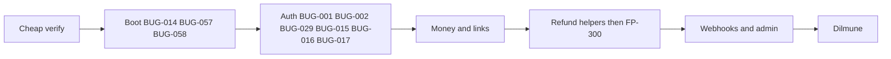

# FilsPay verify-then-fix plan

Follow [finance_ops_security_audit.md](finance_ops_security_audit.md) Document 2: **AUDIT** (done) → **FIX** (smallest change) → **EXPLAIN** (already in `Evidence/bugs/`) → **BUILD** (refunds + Dilmune).

**Bug numbering:** All bug references use the current `BUG-NNN` IDs in [bugs/Readme.md](bugs/Readme.md). Historical IDs are mapped in [bugs/BUG_MERGE_AUDIT.md](bugs/BUG_MERGE_AUDIT.md). The OTP and payment-link RNG reports are merged into BUG-029; the migration and refund-summary join reports are merged into BUG-014.

**Proof is the code.** Fatima’s tickets and YA-before-Feb / ADR-0001 are leads. Ignore MK cover (ADR-0003/0004/0006, ADMIN.md “cannot break the books”, May postmortem, agent files, locked tests that encode the wrong fils) as reasons to skip a fix *or* to invent one.

## Rules for every fix

- One behaviour per change. Prefer a predicate, a function swap, or a unique index over a rewrite.
- Do **not** “freeze” `packages/money`: call `parseBhdToFils` / `allocateRemainder`; do not reintroduce floats or 2-decimal parsing.
- Existing tests that assert the **bug** (CSV `475` fils for `4.75` BD, OTP pending accepted, etc.) are part of the defect. Update those expectations and add `*.new.test.ts` / extra Go cases for the correct rule. Do not treat `npm test` green-on-HEAD as a verifier.
- After each cluster: the cheapest check from the verify playbook (grep / snippet / one curl). Do not full-compose until BUG-014 + BUG-058 work.

## Phase 0 — Cheap verify (do not fix yet)

For each candidate: drop MK-only leads; confirm file:line still matches HEAD; skip rows already `runtime`/`sample` unless you are about to patch them.

Stop if the code no longer matches the note. Do not spend HTTP on parsers, views, or missing indexes.

**Already proven, fix without re-demo:** BUG-001, BUG-029 (OTP portion), BUG-005, BUG-006, BUG-009, BUG-011, BUG-038, BUG-012, BUG-013, BUG-047, BUG-048, BUG-050, BUG-040, BUG-004, BUG-042, BUG-014, BUG-044, BUG-082.

## Phase 1 — App must boot

Without this, Dilmune and `docker compose` score nothing.

1. **BUG-014** — Edit [`db/migrations/0054_views.sql`](../db/migrations/0054_views.sql): replace `settlement_batch_events` with `te.settlement_batch_id IS NULL` (column from 0023). Edit [`db/migrations/0055_chart_of_accounts_suspense.sql`](../db/migrations/0055_chart_of_accounts_suspense.sql) to `INSERT INTO chart_of_accounts (id, name, kind)` matching 0007. Fix [`db/migrations/0072_refund_merchant_summary.sql`](../db/migrations/0072_refund_merchant_summary.sql) join to `r.transaction_id` (same merged bug). In-place is OK on a **fresh** DB (these files never applied). If a DB already recorded the filenames, add 0073+ instead.
2. **BUG-057 / BUG-058** — Add missing `ops/Dockerfile.node` and `ops/Dockerfile.go`; `env_file: .env.docker` on API; 32-byte webhook encryption key; do not commit real secrets. Settlement `SETTLEMENT_INTERNAL_TOKEN` must be set (no fake `dev-token` if Go already requires it — set it in compose).
3. Prove: `npx tsx db/migrate.ts` on empty Postgres reaches 0072.

## Phase 2 — Auth (OTP actually protects)

| Bug | Smallest fix | Files |
|---|---|---|
| BUG-001 | `AND authenticated = true` in `lookupSession` (or the view) | [`apps/api/src/auth/sessions.ts`](../apps/api/src/auth/sessions.ts), [`db/migrations/0058_live_sessions.sql`](../db/migrations/0058_live_sessions.sql) |
| BUG-002 | Drop `findOtpRecipient`; use the login `user` row | [`apps/api/src/routes/auth.ts`](../apps/api/src/routes/auth.ts), [`apps/api/src/auth/users.ts`](../apps/api/src/auth/users.ts) |
| BUG-029 | `crypto.randomInt` in `randomDigits` / `randomFromAlphabet`; payment-link token via `randomToken` | [`apps/api/src/lib/random.ts`](../apps/api/src/lib/random.ts), [`apps/api/src/paymentLinks/create.ts`](../apps/api/src/paymentLinks/create.ts) |
| BUG-015 | `SELECT … FOR UPDATE` or atomic increment; copy `attempt_count` on resend | [`apps/api/src/routes/auth.ts`](../apps/api/src/routes/auth.ts), [`apps/api/src/routes/adminAuth.ts`](../apps/api/src/routes/adminAuth.ts) |
| BUG-016 | New token on `promoteSession`; re-set cookie with full TTL | [`apps/api/src/auth/sessions.ts`](../apps/api/src/auth/sessions.ts) |
| BUG-017 | Join `merchants.status = 'active'` in session + API-key lookup | [`apps/api/src/auth/sessions.ts`](../apps/api/src/auth/sessions.ts), [`apps/api/src/apiKeys/verify.ts`](../apps/api/src/apiKeys/verify.ts) |

Curl: login without OTP → `/v1/auth/me` is 401.

## Phase 3 — Payment links and capture

| Bug | Smallest fix |
|---|---|
| BUG-005 | Public pay ignores `submittedAt` (always server now) in [`apps/api/src/paymentLinks/pay.ts`](../apps/api/src/paymentLinks/pay.ts) / route |
| BUG-006 | `reservation_id` on claim; finalize requires it; void auth if capture fails |
| BUG-018 | `AND merchant_id = $2` in [`apps/api/src/paymentLinks/cancel.ts`](../apps/api/src/paymentLinks/cancel.ts) |
| BUG-022 | Remove `api_keys` hash from public read DTO |
| BUG-023 | Call `applyCaptureDiscountAdjustment` from pay path (or inside `captureTransaction`) |
| BUG-024, BUG-025, BUG-061 | Acquirer reverse on void; capture checks hold expiry; acquirer call **outside** the long DB txn (keep `FOR UPDATE` in short txns) |

## Phase 4 — Money / settlement (ADR-0001)

Ignore ADR-0003/0004/0006. Restore YA rules.

| Bug | Smallest fix |
|---|---|
| BUG-009 | `parseBhdToFils` in [`apps/api/src/admin/adjustmentCsvParsing.ts`](../apps/api/src/admin/adjustmentCsvParsing.ts) |
| BUG-010 | `return grossFils - feeFils` in [`apps/settlement/internal/settlement/payable.go`](../apps/settlement/internal/settlement/payable.go) |
| BUG-034 | Persist scheme `amount` from **truncated** fils; post `gross - truncated` to `scheme_rounding_residue` in CloseBatch (ADR-0002 decision) |
| BUG-011 | `handleRebuildBalances` → `RebuildAllBalances` (ledger), not `RefreshBalanceCache` ([`apps/settlement/internal/internalapi/server.go`](../apps/settlement/internal/internalapi/server.go)) |
| BUG-038 | Route Adjust to `adjustMerchantBalanceJournaled` |
| BUG-035 | MDR recalc only `status = 'closed'` (never paid) |
| BUG-030 | Largest-remainder / port `allocateRemainder` in [`apps/settlement/internal/splits/allocate.go`](../apps/settlement/internal/splits/allocate.go) |
| BUG-071 | Display uses `getEffectiveMdrBps(..., now)` |
| BUG-036 | `BusinessDayWindow`: convert `date` to `businessDayLocation` **before** `Date()`; daemon uses Bahrain “now” |
| BUG-032 | One fee formula (discount amount then MDR) in TS and Go |
| BUG-013 | Empty id list → no-op; `UPDATE … expired` not `DELETE FROM holds` ([`scripts/lib/sqlFilter.ts`](../scripts/lib/sqlFilter.ts), [`scripts/expire_holds.ts`](../scripts/expire_holds.ts)) |
| BUG-033 | Deterministic `entry_group_id` + `WHERE NOT EXISTS`; Bahrain March bounds — or document “do not run” once BUG-034 posts residue |
| BUG-031, BUG-063 | BIGINT / int64 counters |

Snippet: `parseDecimalMinor` gone from CSV; `4.75` → 4750 fils.

## Phase 5 — Refunds then FP-300 (BUILD)

Fix helpers **before** removing the 501.

| Bug | Smallest fix |
|---|---|
| BUG-007 | `refundableFils = captured - refunded` in [`apps/api/src/payments/processRefund.ts`](../apps/api/src/payments/processRefund.ts) |
| BUG-008 | `SELECT … FOR UPDATE`; `refunded_fils = refunded_fils + $n` with cap |
| BUG-003 | `txn.merchant_id !== input.merchantId` → 404 |
| BUG-028 | Never insert NULL `reason` (default `'unspecified'`); do not leave idempotency `in_progress` on 23514 |
| **BUG-027** | Wire [`apps/api/src/routes/refunds.ts`](../apps/api/src/routes/refunds.ts) (and merchant-scoped path the drawer uses) to `initiateMerchantRefund` + idempotency header |
| BUG-045 | Sign and send the **same** body string (`canonicalJson` once) in [`apps/api/src/webhooks/dispatcher.ts`](../apps/api/src/webhooks/dispatcher.ts) |
| Webhook type | Add `refund.succeeded` to `WEBHOOK_ELIGIBLE_EVENT_TYPES` **and** `envelope.ts` (YA comment: type without envelope stalls the queue) |

FP-300 done-when: API round-trip, ledger balanced to the fils, fees/payouts, merchant webhook, timeline + reports (fix BUG-052 / BUG-074 / BUG-014 so rollups are honest). Uncomment [`apps/web/src/pages/transactions/RefundDrawer.tsx`](../apps/web/src/pages/transactions/RefundDrawer.tsx).

## Phase 6 — Webhooks and admin (high score, small diffs)

- **BUG-047, BUG-048:** Require callback signatures in non-dev; `UNIQUE (callback_id)` + `ON CONFLICT DO NOTHING`.
- **BUG-049:** Unique `(event_type, aggregate_id)` on outbox + `INSERT … ON CONFLICT DO NOTHING`.
- **BUG-050:** Record disbursement in Go `PayoutBatch`; remove dispatcher `PRE_DELIVERY_EFFECTS`; unique batch id.
- **BUG-068:** Replay keeps original `delivery_event_id` or skips pre-delivery effects.
- **BUG-039:** `revoked_at = now()` on old key in [`apps/api/src/admin/apiKeys.ts`](../apps/api/src/admin/apiKeys.ts).
- **BUG-040:** Compare `adminUserId` in [`apps/api/src/admin/creditApproval.ts`](../apps/api/src/admin/creditApproval.ts).
- **BUG-041:** `requireAdminRole("finance","super_admin")` on credit create.
- **BUG-004:** Impersonation always merchant `support`; deny capture/void/keys when grant present.
- **BUG-042:** Bulk KYC `WHERE onboarding_status = 'under_review'` + review row.
- **BUG-012:** Never auto-clear `test_mode` from recompute.
- **BUG-046, BUG-051, BUG-019, BUG-053, BUG-020, BUG-044, BUG-037:** raw-body HMAC; deny private webhook URLs; parent-scoped split child; composite export cursor; reporting auth hook; CSV import idempotency; refuse close of today/future.

## Phase 7 — Remaining (if time)

Med/Low AI-only (BUG-061, BUG-054, BUG-072, BUG-075, BUG-073, BUG-055, BUG-079, BUG-064, BUG-069, BUG-080, BUG-081, BUG-076, BUG-082): same smallest-fix rule, after P0–P6. Do not block Dilmune on these.

## Phase 8 — Host on Dilmune Cloud

After BUG-014 + BUG-058 + BUG-057: compose (or Dilmune’s equivalent) with migrate, seed **guarded** (BUG-054: refuse unless `ALLOW_DESTRUCTIVE_SEED`), API, settlement, reporting, web, admin. Confirm `/healthz`, merchant login+OTP, one payment-link pay, one refund, one webhook signature that verifies on the raw body.

## EXPLAIN

Keep [bugs/Readme.md](bugs/Readme.md) as the scoring notes. When a fix lands, add a one-line **Fixed** status + commit/path; do not rewrite the “what’s wrong / why / what it breaks” body.

## Suggested first PR-sized slices

1. Migrations 0054/0055/0072 (BUG-014) + compose/Dockerfiles (BUG-058, BUG-057)
2. Auth cluster (BUG-001, BUG-002, BUG-029, BUG-015, BUG-016, BUG-017)
3. CSV + net payout + rebuild button + expire_holds (BUG-009, BUG-010, BUG-011, BUG-013)
4. Payment links (BUG-005, BUG-006, BUG-018, BUG-023)
5. Refund helpers + route + webhook sign-raw (BUG-007, BUG-008, BUG-003, BUG-027, BUG-045)
6. Admin/webhooks (BUG-047, BUG-048, BUG-049, BUG-050, BUG-068, BUG-051, BUG-039, BUG-040, BUG-041, BUG-004, BUG-012, BUG-042)
